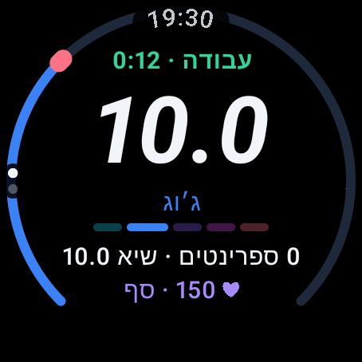
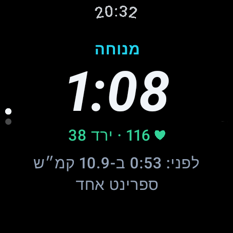
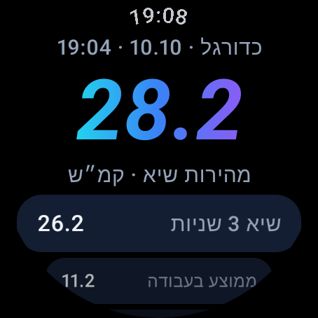

# תקציר — איפה אנחנו עומדים

**10.10.2026 (לילה) · השעון מקליט ריצה וכדורגל, הטלפון מציג היסטוריה, ניתוח ושידור חוזר. הכול נבדק על אמולטורים; שום דבר מזה עוד לא רץ על המכשירים שלך.**

## בשורה אחת

FAST הוא מד-מהירות לשעון עם שני מצבים — **ריצה** ו**כדורגל** — שיודע לבד מתי אתה עובד ומתי אתה נח, ואפליקציית טלפון שמראה את האימון: מספרים, גרפים, ו"סרטון" של המסלול.

## מה נבנה בסבב הזה

ביקשת להמשיך בלי לחכות למדידות מהשטח. מבחן הספרינט נשאר מושהה כמו שהוא; כל השאר התקדם:

| | מה | איפה לקרוא |
|---|---|---|
| **שעון 0.4.0** | הקלטת **ריצה** ו**כדורגל** מקצה לקצה: מוכן → חי → סיכום. מסכי עבודה / ספרינט / מנוחה שמתחלפים לבד, רטט לכל מעבר, היסטוריה והגדרות | [training-recording](spec/training-recording.md) |
| **טלפון 0.3.0** | היסטוריה עם מהירות שיא אישית, מסך אימון כדורגל, מסך ריצה, מסך מבחן ספרינט, **שידור חוזר** (מסלול / מפת חום / ספרינטים), הגדרות | [phone-app](spec/phone-app.md) |
| **סנכרון** | השעון מוסר כל אימון לטלפון ומחכה לאישור; שום דבר לא נמחק | [phone-app § סנכרון](spec/phone-app.md#סנכרון) |
| **שכבת נתונים משותפת** | אימון = קובץ אחד, אותו קוד בשעון ובטלפון | [architecture](architecture/architecture.md#מודל-הנתונים-coredata) |
| **בדיקות** | 144 בדיקות יחידה, כולן עוברות (היו 81) | |

  

## מה חשוב לדעת בכנות

- **על השעון שלך עדיין מותקנת 0.3.0.** לא הייתה דרך להתקין כשאתה לא בבית. כל מה שלמעלה רץ רק על אמולטורים, עם GPS ודופק שאני הזרקתי לפי תסריט.
- **הסנכרון שעון → טלפון לא רץ מקצה לקצה.** חצי השעון נבדק (האימונים נמסרים ל-Play services). חצי הטלפון כתוב אבל לא רץ: צימוד של שני אמולטורים דורש התחברות לחשבון Google, וזה לא משהו שאני עושה. **זה הדבר שהכי סביר שלא יעבוד בניסיון הראשון.**
- **כל הספים עדיין מכוילים על נתונים מדומים**: דקה למנוחה, 12 מ', 85% לספרינט, וציון האמינות של מבחן הספרינט.
- **לא ידוע איך חיישן הדופק וה-GPS של OnePlus Watch 2 מתנהגים** בהקלטה ארוכה עם מסך כבוי, וכמה סוללה זה עולה.
- **כדורגל הוא המקרה הקשה ביותר למדידה מהיד.** ספרינטים של 5–10 מ' ושינויי כיוון חדים ייקראו נמוך מהאמת ב-1Hz. מה שאמין: מבנה האימון, זמן באזורים, ספרינטים של 20 מ' ומעלה.

## החלטות שקיבלתי לבד — כדאי שתעבור עליהן

אמרת "מה שתחליט, אני איתך", אז לא עצרתי. כולן הפיכות, וכולן ב-[decisions](architecture/decisions.md):

1. **אין כפתור Pause, גם לא בריצה.** עצירות מזוהות לבד. (D27)
2. **שכחת לסיים? אחרי 20 דקות בלי תנועה האימון נסגר לבד**, ונחתך לרגע שנעצרת. (D28)
3. **קובץ לכל אימון במקום מסד נתונים.** (D26)
4. **דופק נקרא ישירות מהחיישן**, לא דרך Health Services. (D29)
5. **אזורי המהירות מתעדכנים לכל ההיסטוריה** כשמהירות השיא שלך משתנה. (D31)
6. **שידור חוזר בלי מפה**, והמסלול מסובב כדי למלא את המסך. (D33)

## מה אני צריך ממך

1. **כשתחזור הביתה:** להפעיל Wireless debugging בשעון, ו-USB debugging (או Wireless) בטלפון, ולכתוב לי. אתקין את שתי האפליקציות ונבדוק סנכרון אמיתי.
2. **3–5 מבחני ספרינט בחוץ** — נשאר כמו שסיכמנו.
3. **אימון אחד אמיתי** (ריצה או כדורגל) עם 0.4.0, כדי לכוונן את הספים מול מה שבאמת קרה.

## השאלות שנשארו

הרשימה המלאה ב-[decisions.md](architecture/decisions.md). הקצרות:

- **GitHub** — ליצור ריפו פרטי ולדחוף? עכשיו יש הרבה יותר קוד, ועדיין אין לו גיבוי.
- **Pause בריצה** — לוותר עליו באמת, או שאתה רוצה אותו שם?
- **איפה השעון בזמן כדורגל** — על היד או באפוד/כיס?
- **הצבעים החדשים** — עוד לא אמרת אם הם בסדר. עכשיו יש הרבה יותר מסכים לשפוט לפיהם.

## הצעד הבא

**התקנה על המכשירים האמיתיים ובדיקת סנכרון**, ואחריה כיוונון הספים מאימון אמיתי. ← [roadmap](roadmap.md)
