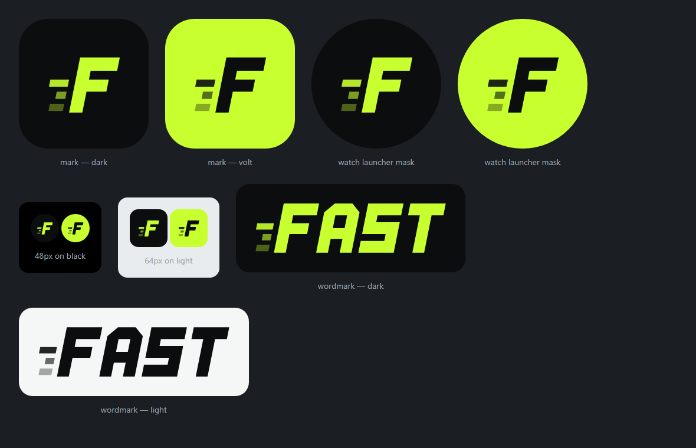

# מותג — FAST



## שם

- **המותג ושם האפליקציה: FAST.** תמיד באותיות גדולות.
- **הריפו והפרויקט: Track-Runner.** שם עבודה גנרי, לא מוצג למשתמש.
- תיאור משני כשצריך: "מד מהירות אישי" / "Speed tracker".

## לוגו

גרסה ראשונה, שנוצרה כולה בקוד: [`tools/brand/generate.mjs`](../../tools/brand/generate.mjs) מייצר מאותה גיאומטריה גם את קובצי ה-SVG שכאן וגם את אייקון האנדרואיד (adaptive icon) של שתי האפליקציות. שינוי בסקריפט + הרצה אחת מעדכן הכול.

**הרעיון:** אותיות בלוקיות נטויות קדימה, עם שלושה פסי מהירות מאחורי ה-F. הסימן המקוצר (F + פסים) הוא האייקון.

| קובץ | שימוש |
|---|---|
| `logo-mark.svg` | סימן, Volt על כהה |
| `logo-mark-volt.svg` | סימן, כהה על Volt — **זה האייקון של האפליקציה** |
| `logo-wordmark.svg` | הלוגו המלא, על כהה |
| `logo-wordmark-light.svg` | הלוגו המלא, על בהיר |

בחרתי באייקון עם רקע Volt כי הוא הכי בולט ומהיר למצוא בלאנצ'ר השחור של השעון. ❓ אם אתה מעדיף את הגרסה הכהה — זו שורה אחת בסקריפט.

## צבעים

| שם | Hex | תפקיד |
|---|---|---|
| **Volt** | `#C8FF2E` | הצבע של המותג: פעולה ראשית, מצב תקין, המהירות החיה |
| **Redline** | `#FF5A36` | שמור לשיאים, לסיום ולאזהרות. לא לקישוט |
| **Ink** | `#0B0D0F` | רקע בטלפון, טקסט על Volt |
| **Black** | `#000000` | רקע בשעון (OLED: לא צורך חשמל ומעלים את המסגרת) |
| **Graphite** | `#16191C` / `#1F2327` | משטחים וכרטיסים |
| **Ice** | `#F4F7F5` | טקסט ראשי |
| **Mist** | `#9AA3AD` | טקסט משני ותוויות |

הממשק כהה בלבד, בשני המכשירים.

## טיפוגרפיה

- **מספרים:** גופן צר, כבד ונטוי, עם ספרות ברוחב קבוע (tabular) כדי שהמספר לא יזוז כשהוא מתחלף. ב-mockups מופיע Bahnschrift כממלא-מקום. מועמדים חופשיים לשימוש: Barlow Condensed, ‏Saira Condensed.
- **טקסט:** גופן שתומך בעברית ובלטינית באותה איכות — Rubik או Heebo.
- ❓ בחירת הגופנים הסופית תיעשה כשנראה את המסך החי על השעון עצמו.

## קול

קצר, ישיר, מספרי. "24.8 קמ״ש · שיא חדש" ולא "כל הכבוד! שברת שיא אישי 🎉".

## פרומפט למודל תמונה

אם תרצה לנסות כיוונים נוספים במודל יצירת תמונות, זה פרומפט שמתאר את הכיוון הנוכחי:

```
Minimal vector logo for a sports speed-tracking app called "FAST".
A bold, heavy, forward-slanted (about 12° italic) geometric letter "F" built from
flat rectangular strokes with sharp corners, with three short horizontal speed
lines trailing behind it on the left, fading in opacity from top to bottom.
Flat design, no gradients, no 3D, no shadows, no texture.
Colors: electric lime-yellow #C8FF2E mark on a near-black #0B0D0F background.
Centered in a square with generous padding so it survives a circular mask
(smartwatch launcher icon). Must stay legible at 48x48 pixels.
Also provide a horizontal lockup with the full word "FAST" in the same blocky
italic lettering. Vector style, crisp edges, professional sportswear-brand feel.
```

וריאציות ששווה לבקש: גרסה עם רקע Volt וסימן שחור; גרסה שבה פסי המהירות חותכים את ה-F במקום לבוא מאחוריו; גרסה שמשלבת סמל "הרצה קדימה" (▶▶).
