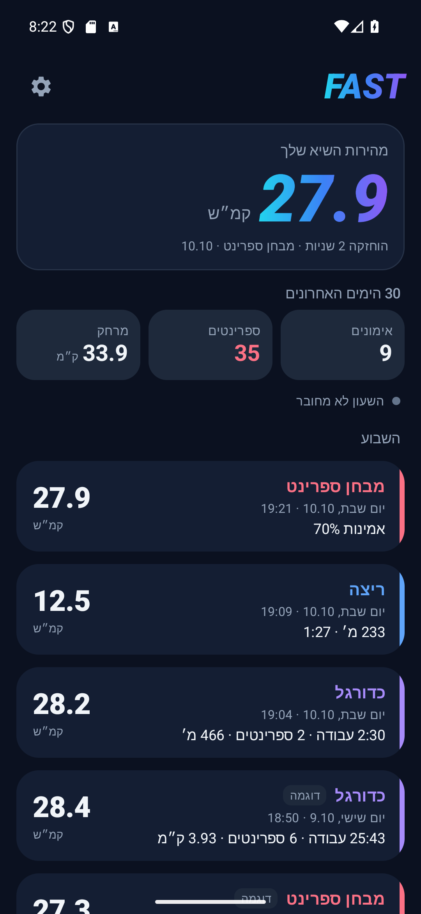
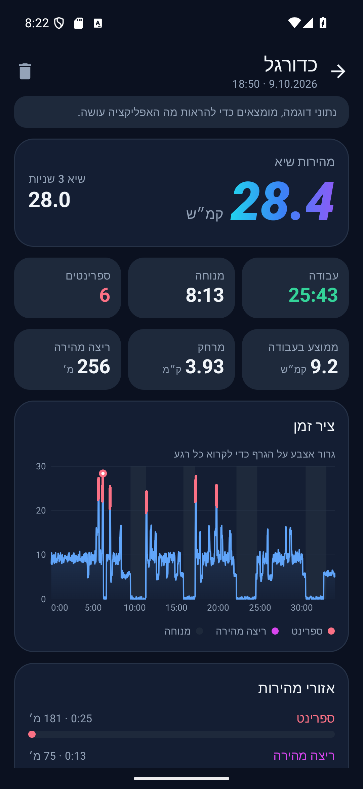
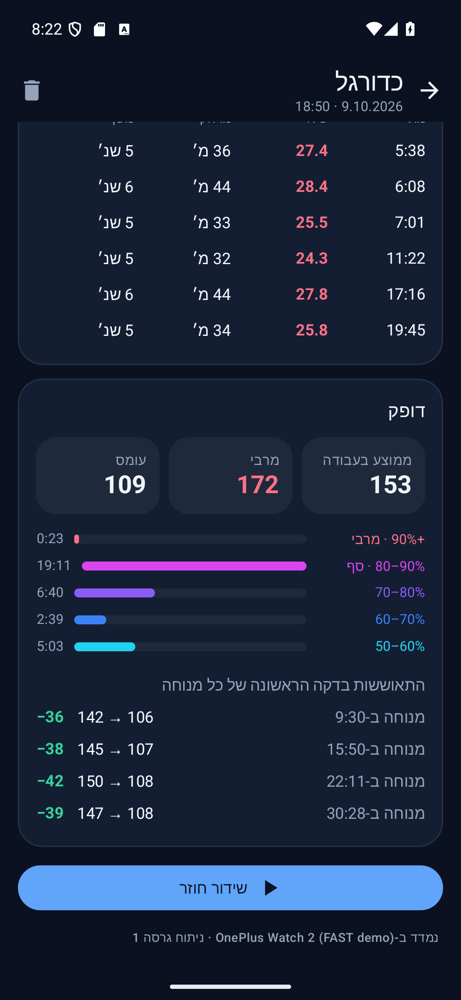
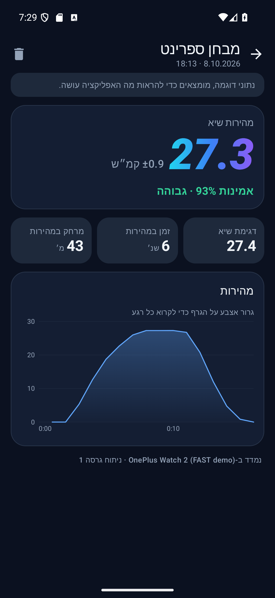
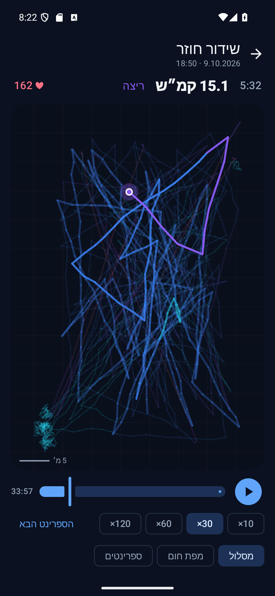

# אפליקציית הטלפון

> גרסה 0.3.1, **מותקנת על ה-OnePlus 13**. המסכים נבדקו על אמולטור עם אימוני דוגמה; **הסנכרון מהשעון נבדק על המכשירים האמיתיים ועבד** (11.10). אימון אמיתי עוד לא הוצג בה. פירוט [בסוף](#מה-נבדק-ומה-לא).

## מה היא עושה

הטלפון הוא המקום שבו **רואים** את האימון: היסטוריה, גרפים, ניתוח כדורגל, ושידור חוזר של המסלול. הוא לא מודד כלום בעצמו (Duo נשאר שאלה פתוחה), ולא נדרש כדי להקליט — השעון עצמאי.

## היסטוריה (מסך הבית)

| היסטוריה | הגדרות |
|---|---|
|  |  |

- **מהירות השיא שלך** — המספר שקובע את אזורי המהירות, עם האימון שבו הושג. זו מהירות ש**הוחזקה** (3 שניות באימון, 2 במבחן ספרינט), לא דגימה בודדת.
- **30 הימים האחרונים** — אימונים, ספרינטים, מרחק.
- **מצב השעון** — מחובר או לא.
- **ריצות, אימוני כדורגל ומבחני ספרינט ברשימה אחת**, מקובצים לפי שבוע. כל כרטיס: סוג, מתי, המספרים שחשובים לסוג הזה, ומהירות השיא בגדול.
- **מבחן ספרינט שהאפליקציה לא סומכת עליו** (אמינות מתחת ל-60) מוצג כך: הציון באדום והמהירות מעומעמת, כדי שלא ייראה כמו תוצאה.

## אימון כדורגל

| למעלה | אזורים וספרינטים | דופק |
|---|---|---|
|  |  |  |

- **מהירות שיא** + שיא 3 שניות.
- **שישה אריחים:** עבודה, מנוחה, ספרינטים · **ממוצע בעבודה** (בלי המנוחות), מרחק, מרחק בריצה מהירה.
- **ציר זמן:** המהירות לאורך כל האימון. המנוחות מוצללות, הספרינטים בוורוד, ריצות מהירות בסגול-ורוד, והרגע המהיר ביותר מסומן. **גרירת אצבע** על הגרף קוראת כל רגע: זמן, מהירות, דופק.
- **אזורי מהירות:** זמן ומרחק בכל אזור.
- **רשימת ספרינטים:** מתי, שיא, מרחק, משך. המשך בשניות שלמות — דגימה אחת לשנייה לא מודדת עשיריות, אז לא מציגים עשיריות.
- **דופק:** ממוצע בעבודה, מרבי, עומס אימון (Edwards), זמן בכל אזור דופק, ו**התאוששות בדקה הראשונה של כל מנוחה** (למשל 150 → 108, ‎−42).

## ריצה ומבחן ספרינט

| ריצה | מבחן ספרינט |
|---|---|
|  |  |

- **ריצה:** שיא, מרחק, זמן ריצה, ממוצע; גרף מהירות; ו**טבלה דקה אחר דקה** (ממוצע ושיא לכל דקה) — התשובה הישירה ל"מה הייתה המהירות לאורך הדקות".
- **מבחן ספרינט:** אותה תוצאה שהשעון הראה — מהירות שיא, אי-ודאות, ציון אמינות והסיבות לו — עם עקומת המהירות של הספרינט. הטלפון **מחשב את הציון מחדש** מהדגימות הגולמיות, כך שאם אלגוריתם הציון ישתפר, גם מבחנים ישנים ישתפרו.

## שידור חוזר

| מסלול | מפת חום | ספרינטים |
|---|---|---|
|  |  |  |

זה ה"סרטון" שביקשת:

- **מסלול:** נקודה שנעה על המגרש בזמן מואץ (‎×10 / ×30 / ×60 / ×120). הדקה וחצי האחרונות זוהרות מאחוריה כמו זנב של שביט, בצבע של אזור המהירות; מה שכבר עבר מעומעם, ומה שעוד לא קרה כמעט שקוף. למעלה: הזמן, המהירות, האזור והדופק של אותו רגע.
- **פס גרירה** לקפיצה לכל רגע, וכפתור **"הספרינט הבא"** שקופץ 3 שניות לפני הספרינט הבא.
- **מפת חום:** איפה בילית את הזמן. פינת המנוחה בולטת — וזה נכון.
- **ספרינטים:** כל ספרינט מצויר וממוספר בנקודת ההתחלה שלו.
- **קנה מידה אמיתי**, עם רשת ופס מידה. **אין מפה מתחת** — שום דבר לא נשלח לשום שרת. בלי מפה אין סיבה ש"צפון" יהיה למעלה, אז המסלול מסובב כך שימלא את המסך.

## הגדרות

- **אזורי מהירות** — מהירות השיא שלך והספים שנגזרים ממנה, כתובים במפורש.
- **גיל** — להערכת דופק מרבי באימונים שהגיעו מהשעון בלי ערך כזה. (השעון שואל את הגיל בעצמו, אז בדרך כלל אין צורך.)
- **שעון** — מצב החיבור, וכפתור "בקש מהשעון את כל האימונים" למקרה שמשהו חסר.
- **בדיקת מכשיר** — המסך הקיים.
- **נתוני דוגמה** — ראה למטה.

## סנכרון

איך אימון מגיע מהשעון:

1. השעון מסיים אימון ומוסר את הקובץ ל-Google Play services (‏`DataClient`).
2. Play services מעביר אותו כשהטלפון בטווח — גם אם שתי האפליקציות סגורות.
3. הטלפון שומר את הקובץ בדיסק, ו**רק אז** כותב אישור.
4. השעון מקבל את האישור, מסמן "סונכרן", ומוחק את העותק הכבד משכבת הסנכרון. האימון עצמו נשאר בשעון.

מה שמגן על ההיסטוריה:

- **אימון לא נמחק מהשעון אף פעם**, וודאי שלא לפני אישור.
- **אותו אימון פעמיים = עותק אחד.** הטלפון מזהה לפי המזהה של האימון.
- **התקנה מחדש של אפליקציית הטלפון:** בפתיחה הראשונה היא מבקשת מהשעון את הכול מחדש. אותו כפתור קיים בהגדרות.
- **אפליקציית השעון הוסרה:** מה שכבר סונכרן בטוח בטלפון; מה שלא — אבוד. לכן השעון מציג כמה אימונים ממתינים.

## נתוני דוגמה

בגרסת הפיתוח (debug) יש כפתור "טען אימוני דוגמה": 9 אימונים מומצאים על פני שלושה שבועות — 4 כדורגל, 3 ריצות, 2 מבחני ספרינט (אחד נקי ואחד עם דגימה שקופצת, שמקבל אמינות נמוכה). הם נכתבים כקובצי אימון רגילים ועוברים **אותה קריאה ואותו ניתוח** כמו אימון אמיתי, אז הם גם בדיקה של כל צד הטלפון.

- מסומנים בתג "דוגמה" ובהערה בראש המסך.
- **לא נספרים למהירות השיא** מהרגע שיש אימון אמיתי אחד.
- נמחקים בכפתור אחד. בגרסת release הם לא קיימים בכלל.

## מה נבדק ומה לא

**נבדק על האמולטור:**
- כל המסכים למעלה, בעברית (RTL), כולל כיווני מספרים, טווחים וסימני מינוס.
- שלושה קבצים שהוקלטו באמולטור **השעון** (כדורגל, ריצה, מבחן ספרינט) הועתקו לטלפון ונתנו אותם מספרים בדיוק כמו בסיכום שעל השעון. כלומר: פורמט הקובץ והניתוח זהים בשני הצדדים.
- צד השעון של הסנכרון: האימונים אכן נמסרים ל-Play services עם הקובץ המצורף.

**נבדק על המכשירים האמיתיים (11.10):**
- **סנכרון מקצה לקצה.** אימון דוגמה שהונח על השעון הגיע לטלפון תוך פחות מ-15 שניות, **כשאפליקציית הטלפון סגורה והמסך כבוי**; הטלפון אישר, השעון סימן "סונכרן", והעותקים הזמניים נמחקו. ← [הבדיקה](../research/field-tests/2026-10-11-first-real-gps.md#סנכרון-אמיתי-עבד-בניסיון-הראשון-)
- האפליקציה מותקנת ונפתחת בלי שגיאות.

**לא נבדק:**
- **איך המסכים נראים על ה-OnePlus 13 עצמו** — לא צילמתי את המסך שלך; הוא היה כבוי.
- אימון שהוקלט רחוק מהטלפון ומגיע כשחוזרים לטווח, ואימון ארוך.
- התנהגות OxygenOS (שנוטה להרוג אפליקציות ברקע) אחרי כמה ימים.
- אימון אמיתי ארוך (שעה ומעלה) — ביצועי הגרף והשידור החוזר נבדקו על 45 דקות מדומות.
