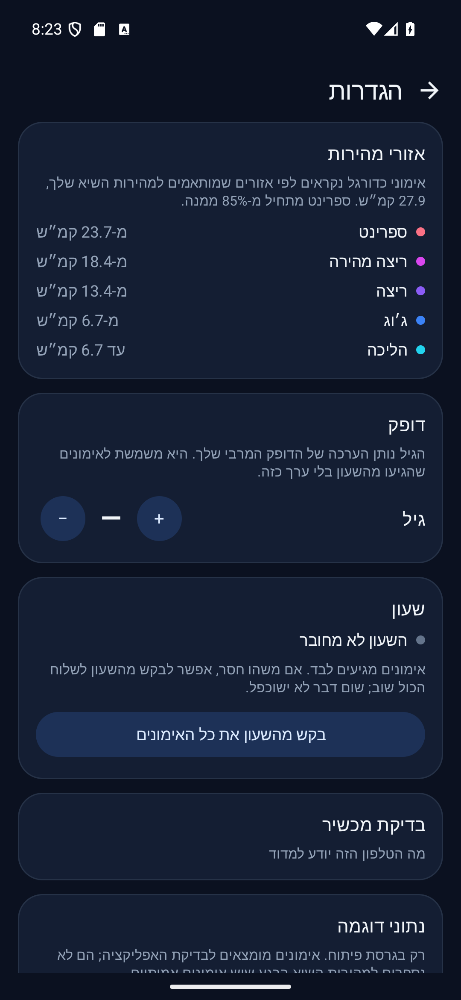
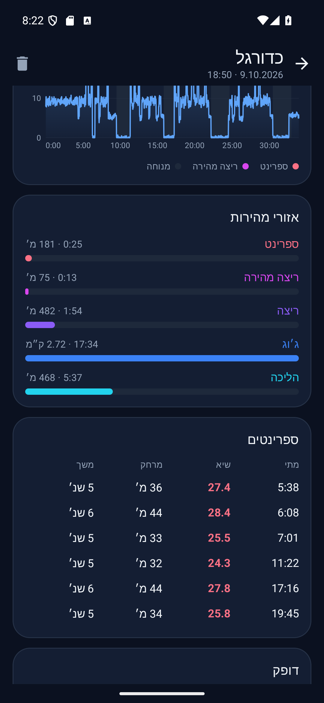
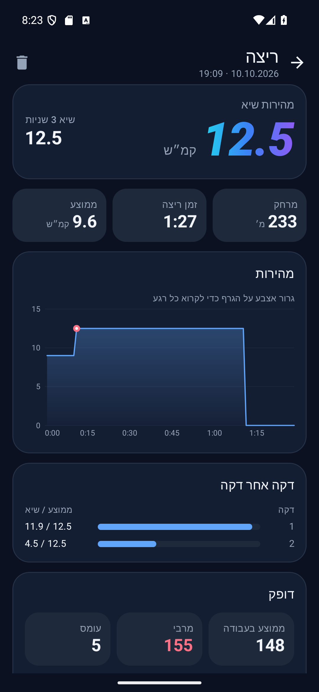
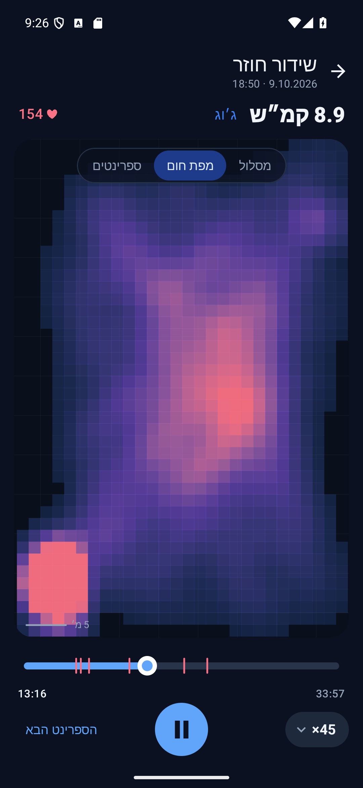
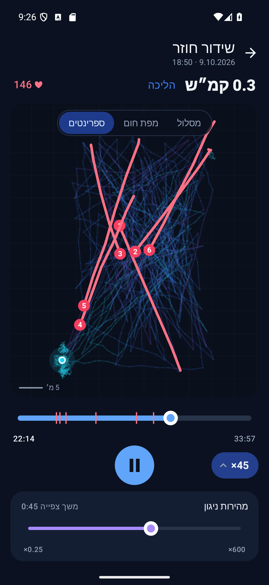
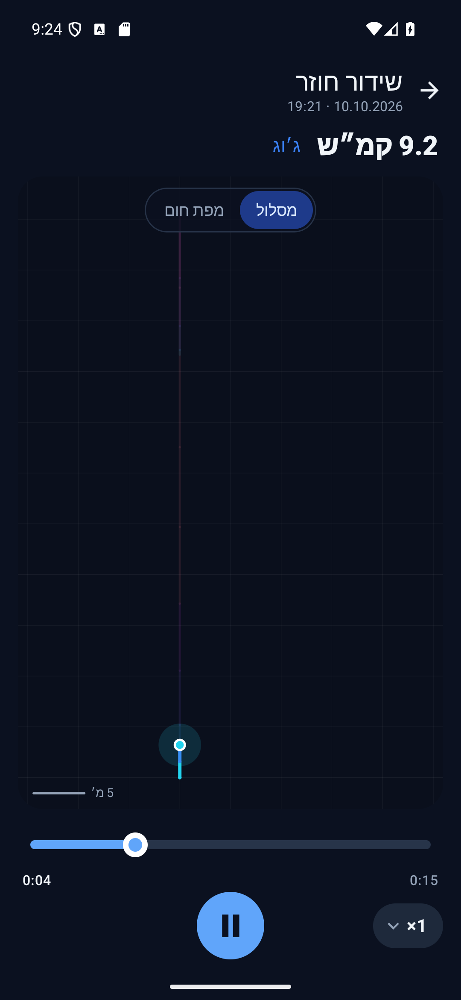

# אפליקציית הטלפון

> גרסה 0.4.0. המסכים נבדקו על אמולטור; **הסנכרון מהשעון נבדק על המכשירים האמיתיים ועבד** (11.10, ושוב ב-13.10 אחרי עדכון המערכת של השעון). ארבעת אימוני הריצה האמיתיים הראשונים נמצאים בה מאז 13.10. פירוט [בסוף](#מה-נבדק-ומה-לא).

## מה היא עושה

הטלפון הוא המקום שבו **רואים** את האימון: היסטוריה, גרפים, ניתוח כדורגל, ושידור חוזר של המסלול. הוא לא מודד כלום בעצמו (Duo נשאר שאלה פתוחה), ולא נדרש כדי להקליט — השעון עצמאי.

## מסך הבית (מ-0.6.0)

| בית | הגדרות |
|---|---|
|  |  |

עד 0.5.0 מסך הבית היה ההיסטוריה כולה, ונראה כמו ארכיון. מ-0.6.0, לפי הבקשה שלך, הוא בנוי כך מלמעלה למטה:

- **מהירות השיא שלך, גדולה,** במסגרת בצבעי המותג. מתחתיה **גרף עמודות של השיא בכל אחד מ-12 האימונים האחרונים**: הישן משמאל, החדש מימין, האימון שקבע את השיא מודגש. לחיצה על הכרטיס פותחת את האימון שקבע אותו.
- **מצב השעון**, ומתי הגיע האימון האחרון ("אחרון: היום 20:40").
- **ריצה משותפת עם השעון** (מ-0.6.2, D47): הכפתור הראשי בכרטיס. מה לעשות בכל מכשיר:
  1. **טלפון:** לחיצה על "ריצה משותפת עם השעון". הטלפון מתחיל למדוד מיד ושולח לשעון הזמנה.
  2. **שעון:** מרטט עם התראה "ריצה משותפת". לחיצה עליה פותחת ריצה; מחכים ש"GPS מוכן" יהיה כחול ולוחצים התחל. בשעון כתוב "הטלפון מודד איתך" בירוק.
  3. **רצים** עם הטלפון צמוד: ביד או בכיס הדוק.
  4. **שעון:** מחזיקים "סיום". הטלפון נעצר לבד, וההשוואה מופיעה ב"המדידות" ובמסך האימון.
  אם השעון לא בטווח, הטלפון כותב זאת באדום וממשיך למדוד; ריצה שתיפתח בשעון בכל זאת תחובר אליו.
- **מדידה מהטלפון**: כפתור התחלה (או, בזמן מדידה, מהירות חיה וכפתור עצירה), ומתג **מדידה משותפת עם השעון**. הקישור "המדידות" מוביל לרשימה עם השוואות שעון-מול-טלפון.
- **שלושת האימונים האחרונים**, וקישור **"להיסטוריה"**: מסך נפרד עם כל האימונים, מקובצים לפי שבוע.
- **30 הימים האחרונים**: אימונים, ספרינטים, מרחק.

ובפירוט:

- **מהירות השיא שלך** — המספר שקובע את אזורי המהירות, עם האימון שבו הושג. זו מהירות ש**הוחזקה** (3 שניות באימון, 2 במבחן ספרינט), לא דגימה בודדת.
- **30 הימים האחרונים** — אימונים, ספרינטים, מרחק.
- **מצב השעון** — מחובר או לא.
- **ריצות, אימוני כדורגל ובדיקות מהירות ברשימה אחת**, כל סוג בצבע ובסמל שלו (אותם צבעים וסמלים כמו בשעון), מקובצים לפי שבוע. כל כרטיס: סוג, מתי, המספרים שחשובים לסוג הזה, ומהירות השיא בגדול.
- **בדיקת מהירות שהאפליקציה לא סומכת עליה** (אמינות מתחת ל-60) מוצג כך: הציון באדום והמהירות מעומעמת, כדי שלא ייראה כמו תוצאה.

## אימון כדורגל

| למעלה | אזורים וספרינטים | דופק |
|---|---|---|
|  |  |  |

- **מהירות שיא** + שיא 3 שניות.
- **שישה אריחים:** עבודה, מנוחה, ספרינטים · **ממוצע בעבודה** (בלי המנוחות), מרחק, מרחק בריצה מהירה.
- **ציר זמן:** המהירות לאורך כל האימון. המנוחות מוצללות, הספרינטים בוורוד, ריצות מהירות בסגול-ורוד, והרגע המהיר ביותר מסומן. **גרירת אצבע** על הגרף קוראת כל רגע: זמן, מהירות, דופק.
- **אזורי מהירות:** זמן ומרחק בכל אזור.
- **רשימת ספרינטים:** מתי, שיא, מרחק, משך. המשך בשניות שלמות — דגימה אחת לשנייה לא מודדת עשיריות, אז לא מציגים עשיריות.
- **דופק:** ממוצע בעבודה, מרבי, עומס אימון (Edwards), זמן בכל אזור דופק, ו**התאוששות בדקה הראשונה של כל מנוחה** (למשל 150 → 108, ‎−42).

## ריצה ובדיקת מהירות

| ריצה | בדיקת מהירות |
|---|---|
|  |  |

- **ריצה:** שיא, מרחק, זמן ריצה, ממוצע; גרף מהירות; ו**טבלה דקה אחר דקה** (ממוצע ושיא לכל דקה) — התשובה הישירה ל"מה הייתה המהירות לאורך הדקות".
- **בדיקת מהירות:** אותה תוצאה שהשעון הראה — מהירות שיא, אי-ודאות, ציון אמינות והסיבות לו — עם עקומת המהירות של הספרינט. הטלפון **מחשב את הציון מחדש** מהדגימות הגולמיות, כך שאם אלגוריתם הציון ישתפר, גם מבחנים ישנים ישתפרו.

## שידור חוזר

| מסלול | מפת חום | ספרינטים |
|---|---|---|
|  |  |  |

זה ה"סרטון" שביקשת. הוא נפתח **כבר מתנגן**, ומגיעים אליו בלחיצה אחת: כפתור "שידור חוזר" בראש מסך האימון (עד 0.3.2 הוא היה בתחתית הדף).

- **מסלול:** נקודה שנעה על המגרש. הדקה וחצי האחרונות זוהרות מאחוריה כמו זנב של שביט, בצבע של אזור המהירות; מה שכבר עבר מעומעם, ומה שעוד לא קרה כמעט שקוף. למעלה: המהירות, האזור והדופק של אותו רגע. **הנקודה גולשת בין דגימה לדגימה** במקום לקפוץ, כך שגם בהילוך איטי התנועה חלקה.
- **מהירות ניגון — מחוון אחד, בלי תקרה שמפריעה.** לחיצה על הכפתור `×30` פותחת מחוון מ-**×0.25** (הילוך איטי) עד **×600**. הצעדים גדלים לאורכו, כך שאותה תזוזת אצבע מכפילה את המהירות בכל מקום עליו, ולצידו כתוב כמה זמן תיקח הצפייה באימון כולו. המהירות שבה נפתח אימון נבחרת לפי אורכו, כך שהכול נראה בכ-40 שניות: בדיקת מהירות נפתחת בזמן אמת, משחק שלם בכ-×120.
- **ציר הזמן:** פס גרירה דק לקפיצה לכל רגע, ו**כל ספרינט מסומן עליו בקו ורוד**, כך שרואים איפה הם ומגיעים אליהם באגודל. כפתור **"הספרינט הבא"** קופץ 3 שניות לפני הבא בתור. נגיעה בתמונה עצמה עוצרת וממשיכה.
- **מפת חום:** איפה בילית את הזמן. פינת המנוחה בולטת — וזה נכון.
- **ספרינטים:** כל ספרינט מצויר וממוספר בנקודת ההתחלה שלו.
- שלושת המבטים נבחרים במתג שצף מעל התמונה, ומתחלפים בהמסה.
- **גם בדיקת מהירות אפשר לנגן** (מ-0.4.0): חמש דגימות עם מיקום מספיקות.
- **קנה מידה אמיתי**, עם רשת ופס מידה. **אין מפה מתחת** — שום דבר לא נשלח לשום שרת. בלי מפה אין סיבה ש"צפון" יהיה למעלה, אז המסלול מסובב כך שימלא את המסך.

| בדיקת מהירות בזמן אמת |
|---|
|  |

## תנועה

- מעבר בין מסכים: החלקה קצרה לכיוון שאליו הולכים (ובחזרה, לכיוון ההפוך) יחד עם עמעום.
- מהירות השיא במסך הבית ובמסך האימון רצה מ-0 אל הערך כשהמסך נפתח; פסי אזורי המהירות גדלים; גרף המהירות מצייר את עצמו מההתחלה.
- כרטיסי ההיסטוריה זזים הצידה כשאימון חדש מגיע מהשעון.

## הגדרות

- **אזורי מהירות** — מהירות השיא שלך והספים שנגזרים ממנה, כתובים במפורש.
- **גיל** — להערכת דופק מרבי באימונים שהגיעו מהשעון בלי ערך כזה. (השעון שואל את הגיל בעצמו, אז בדרך כלל אין צורך.)
- **שעון** — מצב החיבור, וכפתור "בקש מהשעון את כל האימונים" למקרה שמשהו חסר.
- **בדיקת מכשיר** — המסך הקיים. יחד עם "מדידה מהטלפון" הוא נמצא תחת הכותרת **כלים**.
- **אודות** — הגרסה, ושורה אחת על כך שהכול נשאר על השעון והטלפון.
- **מדידה מהטלפון** — כלי בדיקה, לא פיצ'ר: הטלפון מקליט את ה-GPS של עצמו בזמן שהשעון מקליט ריצה, כדי להשוות בין שני המקלטים על אותה ריצה בדיוק. הוא מבקש דגימות בקצב הכי מהיר שהמקלט נותן, ומציג בזמן אמת כמה דגימות בשנייה באמת מגיעות, ואת הדיוק שהמקלט מדווח. ההקלטות נשמרות ב-`files/reference/`, **לא מופיעות בהיסטוריה ולא מסתנכרנות**; קוראים אותן במחשב עם `tools/analysis/compare_devices.py`, שמיישר את שני הקבצים לפי שעון הלוויינים. מ-0.4.1 המסך מציג **את כל המדידות שנשמרו**, ולכל אחת **טבלת "שעון מול טלפון"** מול הקלטת השעון מאותו זמן (שיא 3 שניות לפי מהירות מדווחת ולפי מיקום, מרחק בשתי הדרכים, דגימות בשנייה, הדיוק שכל מקלט מצהיר, והמרחק הממוצע בין המכשירים). אותה טבלה מופיעה גם במסך האימון של השעון. מדידה שנקטעה לפני "עצור" (האפליקציה נסגרה או נעצרה) נשמרת עכשיו עד אותו רגע ומופיעה ברשימה — עד 0.4.0 היא נשארה קובץ חלקי שלא הוצג, וזה מה שקרה במדידה של 14.10. ההשוואה האמיתית הראשונה (20.10, ריצה של 15 שניות בכ-14 קמ"ש): שני המקלטים נותנים דגימה אחת בשנייה; הטלפון מצהיר דיוק אמיתי והשעון לא; המהירות המדווחת של השעון קופצת יותר, והמיקומים של שניהם מסכימים בטווח של כ-5 מ׳.

## סנכרון

איך אימון מגיע מהשעון:

1. השעון מסיים אימון ומוסר את הקובץ ל-Google Play services (‏`DataClient`).
2. Play services מעביר אותו כשהטלפון בטווח — גם אם שתי האפליקציות סגורות.
3. הטלפון שומר את הקובץ בדיסק, ו**רק אז** כותב אישור.
4. השעון מקבל את האישור, מסמן "סונכרן", ומוחק את העותק הכבד משכבת הסנכרון. האימון עצמו נשאר בשעון.

מה שמגן על ההיסטוריה:

- **אימון לא נמחק מהשעון אף פעם**, וודאי שלא לפני אישור.
- **אותו אימון פעמיים = עותק אחד.** הטלפון מזהה לפי המזהה של האימון.
- **התקנה מחדש של אפליקציית הטלפון:** בפתיחה הראשונה היא מבקשת מהשעון את הכול מחדש. אותו כפתור קיים בהגדרות.
- **אפליקציית השעון הוסרה:** מה שכבר סונכרן בטוח בטלפון; מה שלא — אבוד. לכן השעון מציג כמה אימונים ממתינים.

## נתוני דוגמה — הוסרו מהממשק

עד 0.3.2 היו בגרסת הפיתוח כפתורי "טען אימוני דוגמה" בהיסטוריה הריקה ובהגדרות. ביקשת להעיף אותם, ומ-0.4.0 **אין להם שום כפתור**. המחולל עצמו נשאר בקוד של גרסת הפיתוח בלבד, כדי שאפשר יהיה לבדוק מסכים על אמולטור, ומופעל רק מהמחשב (`adb shell am start -n com.hananel.fast/.mobile.MainActivity --es demo add`, ו-`--es demo remove` להסרה). בגרסת release הוא לא קיים בכלל.

אימון דוגמה, אם יש כזה, עדיין מסומן בתג "דוגמה" ולא נספר למהירות השיא מהרגע שיש אימון אמיתי אחד.

## מה נבדק ומה לא

**נבדק על האמולטור:**
- כל המסכים למעלה, בעברית (RTL), כולל כיווני מספרים, טווחים וסימני מינוס.
- שלושה קבצים שהוקלטו באמולטור **השעון** (כדורגל, ריצה, מבחן ספרינט) הועתקו לטלפון ונתנו אותם מספרים בדיוק כמו בסיכום שעל השעון. כלומר: פורמט הקובץ והניתוח זהים בשני הצדדים.
- צד השעון של הסנכרון: האימונים אכן נמסרים ל-Play services עם הקובץ המצורף.

**נבדק על המכשירים האמיתיים (11.10):**
- **סנכרון מקצה לקצה.** אימון דוגמה שהונח על השעון הגיע לטלפון תוך פחות מ-15 שניות, **כשאפליקציית הטלפון סגורה והמסך כבוי**; הטלפון אישר, השעון סימן "סונכרן", והעותקים הזמניים נמחקו. ← [הבדיקה](../research/field-tests/2026-10-11-first-real-gps.md#סנכרון-אמיתי-עבד-בניסיון-הראשון-)
- האפליקציה מותקנת ונפתחת בלי שגיאות.

**לא נבדק:**
- **איך המסכים נראים על ה-OnePlus 13 עצמו** — לא צילמתי את המסך שלך; הוא היה כבוי.
- אימון שהוקלט רחוק מהטלפון ומגיע כשחוזרים לטווח, ואימון ארוך.
- התנהגות OxygenOS (שנוטה להרוג אפליקציות ברקע) אחרי כמה ימים.
- אימון אמיתי ארוך (שעה ומעלה) — ביצועי הגרף והשידור החוזר נבדקו על 45 דקות מדומות.
