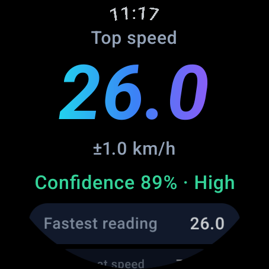

# מבחן ספרינט — "כמה אתה מהיר?"

הפיצ'ר הראשון שעובד מקצה לקצה על השעון: לחיצה, ספרינט אחד, ומהירות שיא עם ציון אמינות.

| | | |
|---|---|---|
|  |  |  |
|  |  | |

הצילומים מאמולטור Wear OS 5, עם GPS מדומה.

## הזרימה

1. **בית ← "מבחן ספרינט".** בפעם הראשונה מתבקשת הרשאת מיקום.
2. **מוכן.** ה-GPS נדלק. שלוש הוראות: משטח ישר, מישורי ופתוח · ספרינט אחד ארוך · להחזיק מהירות שיא 3 שניות. כפתור "התחל" נפתח רק כשהקליטה טובה — התחלה על קליטה חלשה היא הדרך הנפוצה ביותר לקבל מדידה גרועה, אז היא פשוט לא מוצעת.
3. **ספירה לאחור** 3-2-1 עם רטט בכל פעימה, ורטט ארוך ב"צא".
4. **ריצה.** המהירות בגדול והשיא מתחתיה. **המבחן מסתיים לבד** כשהאטת בבירור (שתי דגימות מתחת לחצי מהשיא). אפשר גם לעצור ידנית. אם אף אחד לא רץ תוך 15 שניות — מסתיים.
5. **תוצאה** עם רטט כפול: מהירות שיא, אי-ודאות (±), ציון אמינות, ואם משהו פגע במדידה — מה. "נסה שוב" מודגש כשהאמינות נמוכה.

המסך נשאר דולק לאורך כל המבחן, וה-GPS נכבה ברגע שיוצאים מהמסך.

## מבחנים שמורים

כל מבחן נשמר על השעון **לבד, ברגע שהוא מסתיים** — אין כפתור שמירה ואין מה לזכור. נשמרים שני דברים:

- **התוצאה:** מתי, מהירות שיא, אמינות, ומה פגע במדידה. זה מה שמופיע במסך "מבחנים שמורים" שבמסך הבית.
- **כל דגימות ה-GPS של אותו מבחן**, כפי שהגיעו. את אלה לא רואים על השעון; הן שם כדי שאפשר יהיה לבדוק ולכוונן את הניקוד מול ספרינטים אמיתיים.


הנתונים נשארים באחסון הפרטי של האפליקציה על השעון. הם נמחקים רק אם מסירים את האפליקציה.

## מהי "מהירות השיא"

**הממוצע הטוב ביותר על פני שתי שניות, אחרי שדגימות בודדות חריגות הוצאו.**

לא הדגימה המהירה ביותר — מהסיבות שב-[מחקר הדיוק](../research/02-speed-accuracy.md#23-מקסימום-של-סדרה-רועשת-תמיד-מנופח): מקסימום גולמי מנופח סטטיסטית, וכל רעש בודד הופך ל"שיא". בפועל:

- כל דגימה מוחלפת בחציון שלה ושל שתי שכנותיה. ערך שעומד לבד — רעש, או מהירות שנגעת בה לדגימה אחת — נעלם. כל מה שהוחזק שתי דגימות ומעלה לא משתנה.
- מהסדרה הנקייה נבחר חלון שתי השניות המהיר ביותר.

זו הסיבה להוראה "החזק 3 שניות": מהירות שהוחזקה היא מה שנמדד.

הדגימה המהירה ביותר עדיין מוצגת, בשורה משנית, לסקרנות.

## ציון האמינות

מספר בין 0 ל-100 שעונה על שאלה אחת: **כמה הדגימות תומכות במספר שמוצג.** הוא לא הבטחת דיוק מול מד מהירות אמיתי — את זה אי אפשר לדעת מתוך השעון.

חמש בדיקות בלתי תלויות, כל אחת שואלת שאלה אחרת:

| בדיקה | השאלה | ציון מלא | אפס |
|---|---|---|---|
| **כיסוי** | היו מספיק דגימות, בלי חורים, בזמן הריצה המהירה? | 5 דגימות ומעלה, רצופות | 2 דגימות, או חור של 3 שניות |
| **אות** | מה המקלט עצמו דיווח על איכות הקליטה? | אי-ודאות מהירות עד 0.3 מ'/ש | 1.5 מ'/ש ומעלה |
| **יציבות** | הדגימות בתוך חלון השיא מסכימות ביניהן? | פיזור עד 6% | 30% ומעלה |
| **קפיצות** | הייתה דגימה שקפצה יותר ממה שאדם מסוגל להאיץ? | אין | יש (מוריד לחצי) |
| **התאמה** | המרחק שנעבר בפועל תואם למהירות שדווחה? | סטייה עד 10% | 40% ומעלה |

**בדיקת ההתאמה היא החזקה ביותר.** המהירות נמדדת מהסטת דופלר והמיקום ממדידת מרחק ללוויינים — שתי מדידות נפרדות. בספרינט ישר הן חייבות לספר אותו סיפור, ותקלה באחת כמעט אף פעם לא מטעה את השנייה. (זו גם הסיבה להוראה "משטח ישר".)

### איך משלבים — ולמה זה קשה להשגה

```
אמינות = √( הבדיקה החלשה ביותר × הממוצע הגיאומטרי של כולן )
```

חצי מהמשקל על החוליה החלשה, חצי על התמונה הכללית. בממוצע רגיל, ארבע בדיקות מושלמות היו מחפות על אחת גרועה: בדיקה אחת על 50% הייתה משאירה את הציון מעל 80%. כאן היא מורידה אותו לכ-65%.

**בדיקה שאי אפשר לבצע מגבילה את הציון, לא נחשבת כעוברת:**
- המקלט לא מדווח אי-ודאות מהירות ← תקרה של 85.
- אין מיקומים להשוואה ← תקרה של 80.

שתיקה של המקלט היא לא ראיה לאיכות.

**רמות:** 80 ומעלה גבוהה · 60–79 בינונית · מתחת ל-60 נמוכה, עם המלצה לנסות שוב.

### מתי אין תוצאה בכלל

| מצב | מה מוצג |
|---|---|
| לא הגעת ל-12 קמ"ש | "לא זוהה ספרינט" |
| פחות מ-4 דגימות, או דגימות רחוקות מדי זו מזו | "אין מספיק נתוני GPS" |
| מעל 45 קמ"ש גם אחרי סינון רעשים | "זו לא הייתה ריצה" |

## למה זה לא מייצר תוצאות שווא

זה מה שביקשת לוודא. 31 בדיקות אוטומטיות, ולכל דרך שבה מדידה יכולה להיות גרועה יש בדיקה שמוודאת שהציון יורד:

| תרחיש | תוצאה |
|---|---|
| ספרינט נקי, 26 קמ"ש מוחזקים 5 שניות | 26.0, אמינות 100 |
| החזקת 20, דגימה אחת קפצה ל-31 | **20.0** (לא 31, ולא ממוצע מנופח), בינונית, "דגימה אחת קפצה" |
| הקפיצה בתוך קטע המהירות היחיד | נמוכה |
| קפיצה ל-70 קמ"ש באמצע ספרינט אמיתי | הספרינט נמדד, הקפיצה מסומנת — לא נדחה כ"רכב" |
| נגעת ב-26 ומיד האטת | נמוכה, "לא הוחזקה מספיק זמן" |
| המקלט מדווח קליטה גרועה | נמוכה, "אות חלש" |
| המהירות אומרת 26, המיקומים זזו שליש מזה | נמוכה, "המרחק לא תואם" |
| חסרה דגימה באמצע | הציון יורד |
| פרץ קצר מאוד | לא גבוהה, "מעט מדי דגימות" |
| המקלט לא מדווח שום איכות | לא יכולה להיות גבוהה |
| רעש באמצע הריצה | המבחן **לא** מסתיים בטעות |

בנוסף, הזרימה כולה הורצה על אמולטור עם שני תרחישים מדומים: ספרינט נקי (26.0, אמינות 89) וספרינט עם רעש (20.0, אמינות 65, הרעש זוהה).

## מה עוד לא ידוע

**הספים כוילו על נתונים סינתטיים, לא על ספרינטים אמיתיים.** מה שיתברר רק מהשעון שלך:

- האם המקלט בכלל מדווח אי-ודאות מהירות. [דוח החומרה](../research/field-tests/2026-10-10-watch-device-report.md) רומז שלא — ואז התקרה היא 85.
- כמה רעש מוסיפה תנודת היד בספרינט, והאם סף ה"יציבות" (6%–30%) מתאים לזה.
- האם הדגימות באמת מגיעות כל שנייה בריצה.

**לכן כל מבחן נשמר על השעון כולו** — כל דגימה כפי שהגיעה — ואפשר להריץ אותו מחדש אחרי שמשנים את הניקוד. אחרי כמה ספרינטים אמיתיים אמשוך את הקבצים ואכוונן.

## מגבלה שלא תיעלם

דגימה אחת לשנייה. ספרינט שבו מחזיקים שיא פחות משתי שניות לא יימדד טוב, והמבחן יגיד את זה ("לא הוחזקה") במקום להמציא מספר.

## איפה הקוד

| | |
|---|---|
| `core/tracking/.../sprint/SprintTestAnalyzer.kt` | מהירות השיא וציון האמינות. Kotlin טהור |
| `core/tracking/.../sprint/SprintLive.kt` | מוכנות ה-GPS, וזיהוי התחלה וסיום בזמן אמת |
| `wear/.../sprint/GnssSpeedSource.kt` | קריאת ה-GPS של השעון עצמו (לא של הטלפון) |
| `wear/.../sprint/SprintTestViewModel.kt` | מכונת המצבים של המבחן |
| `wear/.../sprint/SprintTestScreen.kt` | המסכים |
| `wear/.../sprint/SprintLog.kt` | שמירת הדגימות והתוצאות על השעון, וקריאתן חזרה |
| `wear/.../sprint/SprintHistoryScreen.kt` | מסך "מבחנים שמורים" |
