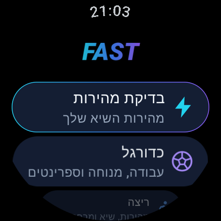
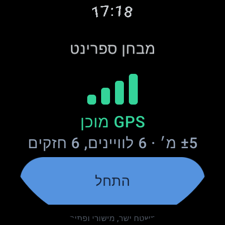
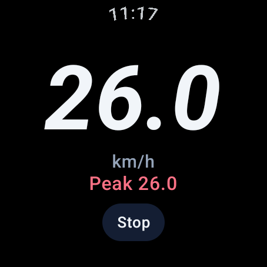
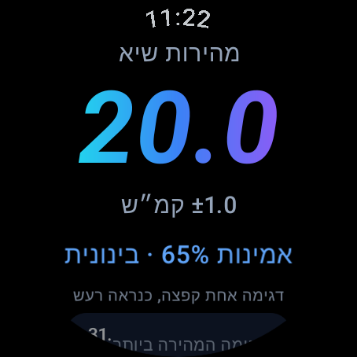
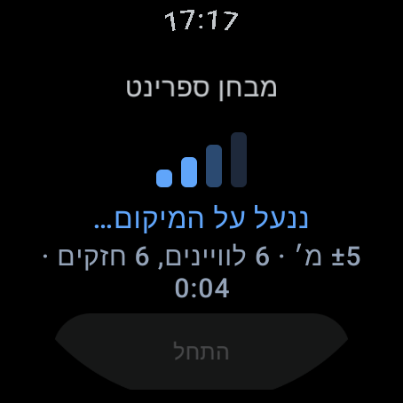
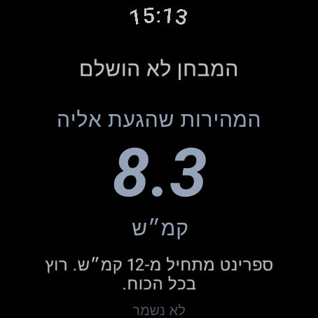
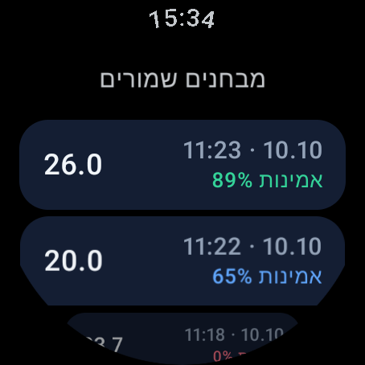

# מבחן ספרינט — "כמה אתה מהיר?"

הפיצ'ר הראשון שעובד מקצה לקצה על השעון: לחיצה, ספרינט אחד, ומהירות שיא עם ציון אמינות.

| | | |
|---|---|---|
|  |  |  |
|  |  | |

הצילומים מאמולטור Wear OS 5, עם GPS מדומה.

## הזרימה

1. **בית ← "מבחן ספרינט".** בפעם הראשונה מתבקשת הרשאת מיקום.
2. **חיפוש GPS.** ה-GPS נדלק ומד אות מראה מה קורה (פירוט למטה). כפתור "התחל" נפתח ברגע שיש זרם יציב של דגימות עם מהירות. מתחתיו שלוש ההוראות: משטח ישר, מישורי ופתוח · ספרינט אחד ארוך · להחזיק מהירות שיא 3 שניות.
3. **ספירה לאחור** 3-2-1 עם רטט בכל פעימה, ורטט ארוך ב"צא".
4. **ריצה.** המהירות בגדול והשיא מתחתיה. **המבחן מסתיים לבד** כשהאטת בבירור (שתי דגימות מתחת לחצי מהשיא). אפשר גם לעצור ידנית. אם אף אחד לא רץ תוך 15 שניות — מסתיים.
5. **תוצאה** עם רטט כפול: מהירות שיא, אי-ודאות (±), ציון אמינות, ואם משהו פגע במדידה — מה. "נסה שוב" מודגש כשהאמינות נמוכה.
6. **או: "המבחן לא הושלם"** עם רטט אחד ארוך — כשלא יצאה מדידה. ראה [למטה](#כשאין-תוצאה).

**המבחן רץ גם כשהמסך כבוי.** החיפוש, הספירה לאחור והמדידה חיים בשירות רקע, לא במסך. אפשר להוריד את היד; השעון רוטט פעמיים כשה-GPS מוכן, בכל פעימת ספירה, ובסיום. ה-GPS נכבה כשמחליקים החוצה ממסך המבחן, או לבד אחרי 10 דקות בלי שימוש.

### הבאג שהוביל לזה
בגרסה הראשונה ה-GPS היה קשור למסך: כשהמסך נכבה, ה-GPS נכבה איתו. בשעון שלך המסך נכבה אחרי **5 שניות**, וגם כשמורידים את היד. היומן של השעון עצמו הראה את התוצאה: תשעה חיפושים, באורך של 3 עד 31 שניות כל אחד, ואף דגימת מיקום אחת מאז ההפעלה. חיפוש ראשון צריך לפחות חצי דקה רצופה גם בתנאים טובים, אז הוא לא יכול היה להצליח — ובספרינט אמיתי, תנועת היד הייתה קוטעת את המדידה באותה צורה.

אותו יומן הראה גם שהאות בבית היה חלש מאוד (כ-20 dB-Hz; נעילה דורשת בערך 30 ומעלה), כך שגם בלי הבאג לא הייתה נעילה בפנים.

## מסך החיפוש — מה רואים בזמן שמחכים



הגרסה הראשונה הציגה רק "מחפש GPS" עד שהכפתור נפתח, ואי אפשר היה לדעת אם משהו קורה. עכשיו:

- **ארבעה פסי קליטה**, כמו בטלפון. הפס הבא בתור מהבהב כל עוד החיפוש נמשך.
- **שלב החיפוש במילים:**

| פסים | מה כתוב | מה זה אומר |
|---|---|---|
| 0 | מחפש לוויינים… | המקלט לא שומע כלום. בתוך בית זה נשאר כאן |
| 1 | נמצאו לוויינים | שומע כמה, אבל לא מספיק ברור |
| 2 | ננעל על המיקום… | יש 4 לוויינים חזקים ומעלה, או שהדגימות הראשונות מגיעות |
| 2 | יש מיקום, אין מהירות | המקלט שולח מיקום בלי נתון מהירות; המבחן לא יכול לרוץ על זה |
| 3 | אות חלש | דגימות מגיעות ברצף אבל המקלט מדרג אותן נמוך. **אפשר להתחיל**, והציון יהיה נמוך בהתאם |
| 4 | GPS מוכן | — |

- **פרטים:** כמה לוויינים נראים וכמה מהם חזקים, והדיוק במטרים ברגע שיש מיקום.
- **שעון רץ** של זמן החיפוש.
- **רמז אחרי 20 שניות:** "בפנים זה יכול לקחת דקות. הכי מהר תחת שמיים פתוחים."

**שני שינויים מהותיים, לא רק תצוגה:**
1. **אות חלש כבר לא חוסם התחלה.** לא ידוע עדיין אילו ערכי דיוק השעון שלך מדווח בחוץ; סף קשיח היה עלול להשאיר את הכפתור נעול לנצח. ציון האמינות ממילא ישקף אות חלש.
2. **"יש מיקום, אין מהירות" הוא מצב בפני עצמו.** קודם, מקלט ששולח מיקום בלי מהירות היה משאיר את המסך על "מחפש" בלי סוף. עכשיו זה נאמר במפורש.

### יומן חיפוש
כל חיפוש נרשם לקובץ על השעון (בלי מיקומים): מתי התחיל, מתי נשמעו לוויינים ראשונים וכמה, כמה זמן לקח עד הדגימה הראשונה, והאם היא כללה מהירות ואי-ודאות מהירות. כך אפשר לברר אחר כך למה חיפוש נתקע, גם אם השעון לא היה מחובר למחשב באותו רגע.

## כשאין תוצאה



מבחן שלא הפיק מדידה — הלכת במקום לרוץ, לא יצאת לדרך, או שה-GPS נפל — **לא נשמר כמבחן**. הוא לא מופיע ב"מבחנים שמורים" ולא נשלח לטלפון: רשומה בלי מספר היא רק רעש.

המסך אומר מה קרה במקום להראות מסך ריק:

| מה קרה | מה כתוב |
|---|---|
| זזת, אבל לא מספיק מהר | **המהירות שהגעת אליה** (הטובה ביותר שהוחזקה 2 שניות), ו"ספרינט מתחיל מ-12 קמ"ש" |
| לא זזת בכלל (מתחת ל-3 קמ"ש) | "לא זוהתה ריצה. צא לדרך מיד אחרי הרטט הארוך" |
| ה-GPS נפל באמצע | "ה-GPS איבד את האות. נסה במקום פתוח יותר" |
| מהר מדי לאדם | "המבחן לא מתאים לנסיעה או לרכיבה" |

ותמיד: **"לא נשמר"**, וכפתור "נסה שוב".

הדגימות הגולמיות של ניסיון כזה כן נכתבות ליומן שעל השעון — לא כמבחן, אלא כדי שאפשר יהיה לברר אחר כך למה הוא נכשל.

## מבחנים שמורים

כל מבחן **שנתן תוצאה** נשמר על השעון **לבד, ברגע שהוא מסתיים** — אין כפתור שמירה ואין מה לזכור. נשמרים שני דברים:

- **התוצאה:** מתי, מהירות שיא, אמינות, ומה פגע במדידה. זה מה שמופיע במסך "מבחנים שמורים" שבמסך הבית.
- **כל דגימות ה-GPS של אותו מבחן**, כפי שהגיעו. את אלה לא רואים על השעון; הן שם כדי שאפשר יהיה לבדוק ולכוונן את הניקוד מול ספרינטים אמיתיים.



הנתונים נשארים באחסון הפרטי של האפליקציה על השעון. הם נמחקים רק אם מסירים את האפליקציה.

## מהי "מהירות השיא"

**הממוצע הטוב ביותר על פני שתי שניות, אחרי שדגימות בודדות חריגות הוצאו.**

לא הדגימה המהירה ביותר — מהסיבות שב-[מחקר הדיוק](../research/02-speed-accuracy.md#23-מקסימום-של-סדרה-רועשת-תמיד-מנופח): מקסימום גולמי מנופח סטטיסטית, וכל רעש בודד הופך ל"שיא". בפועל:

- כל דגימה מוחלפת בחציון שלה ושל שתי שכנותיה. ערך שעומד לבד — רעש, או מהירות שנגעת בה לדגימה אחת — נעלם. כל מה שהוחזק שתי דגימות ומעלה לא משתנה.
- מהסדרה הנקייה נבחר חלון שתי השניות המהיר ביותר.

זו הסיבה להוראה "החזק 3 שניות": מהירות שהוחזקה היא מה שנמדד.

הדגימה המהירה ביותר עדיין מוצגת, בשורה משנית, לסקרנות.

## ציון האמינות

מספר בין 0 ל-100 שעונה על שאלה אחת: **כמה הדגימות תומכות במספר שמוצג.** הוא לא הבטחת דיוק מול מד מהירות אמיתי — את זה אי אפשר לדעת מתוך השעון.

חמש בדיקות בלתי תלויות, כל אחת שואלת שאלה אחרת:

| בדיקה | השאלה | ציון מלא | אפס |
|---|---|---|---|
| **כיסוי** | היו מספיק דגימות, בלי חורים, בזמן הריצה המהירה? | 5 דגימות ומעלה, רצופות | 2 דגימות, או חור של 3 שניות |
| **אות** | כמה טובה הייתה הקליטה? לפי דיווח המקלט אם הוא אמין; אחרת לפי הלוויינים (ראה למטה) | אי-ודאות מהירות עד 0.3 מ'/ש · או 10 לוויינים בשימוש ו-6 חזקים | 1.5 מ'/ש ומעלה · או 4 בשימוש, או עד אחד חזק |
| **יציבות** | הדגימות בתוך חלון השיא מסכימות ביניהן? | פיזור עד 6% | 30% ומעלה |
| **קפיצות** | הייתה דגימה שקפצה יותר ממה שאדם מסוגל להאיץ? | אין | יש (מוריד לחצי) |
| **התאמה** | המרחק שנעבר בפועל תואם למהירות שדווחה? | סטייה עד 10% | 40% ומעלה |

### המקלט של השעון שלך לא מדרג את עצמו

ה-OnePlus Watch 2 מדווח על **כל** דגימה אותו "דיוק": 25 מ'/ש במהירות ו-125 מ' במיקום — בשמיים פתוחים ובמרפסת כאחד ([הממצא](../research/field-tests/2026-10-11-first-real-gps.md)). זה ערך ברירת מחדל, לא מדידה. לכן:

- **דיוק שאף מקלט עובד לא היה מודה בו** (10 מ'/ש ומעלה, או 100 מ' ומעלה) נחשב **"לא דווח"** — לא טוב ולא רע.
- בדיקת האות נשענת אז על מה שכן ידוע: **כמה לוויינים בשימוש וכמה מהם חזקים**, ברגע החלש ביותר של המבחן. צריך את שניהם: הרבה לוויינים חלשים, או מעט חזקים, הם קליטה גרועה.
- בבדיקת ההתאמה, "125 מ'" **לא נסלח** כטעות מיקום — אחרת כל אי-התאמה הייתה עוברת. במקומו מניחים טעות GPS רגילה של 5 מ'.
- התקרה של 85 נשארת: המקלט עדיין לא אמר כמה הוא בטוח במהירות. **על השעון הזה, 85% הוא המקסימום.**

**בדיקת ההתאמה היא החזקה ביותר.** המהירות נמדדת מהסטת דופלר והמיקום ממדידת מרחק ללוויינים — שתי מדידות נפרדות. בספרינט ישר הן חייבות לספר אותו סיפור, ותקלה באחת כמעט אף פעם לא מטעה את השנייה. (זו גם הסיבה להוראה "משטח ישר".)

### איך משלבים — ולמה זה קשה להשגה

```
אמינות = √( הבדיקה החלשה ביותר × הממוצע הגיאומטרי של כולן )
```

חצי מהמשקל על החוליה החלשה, חצי על התמונה הכללית. בממוצע רגיל, ארבע בדיקות מושלמות היו מחפות על אחת גרועה: בדיקה אחת על 50% הייתה משאירה את הציון מעל 80%. כאן היא מורידה אותו לכ-65%.

**בדיקה שאי אפשר לבצע מגבילה את הציון, לא נחשבת כעוברת:**
- המקלט לא מדווח אי-ודאות מהירות ← תקרה של 85.
- אין מיקומים להשוואה ← תקרה של 80.

שתיקה של המקלט היא לא ראיה לאיכות.

**רמות:** 80 ומעלה גבוהה · 60–79 בינונית · מתחת ל-60 נמוכה, עם המלצה לנסות שוב.

### מתי אין תוצאה בכלל

| מצב | מה מוצג |
|---|---|
| לא הגעת ל-12 קמ"ש | "לא זוהה ספרינט" |
| פחות מ-4 דגימות, או דגימות רחוקות מדי זו מזו | "אין מספיק נתוני GPS" |
| מעל 45 קמ"ש גם אחרי סינון רעשים | "זו לא הייתה ריצה" |

## למה זה לא מייצר תוצאות שווא

זה מה שביקשת לוודא. 31 בדיקות אוטומטיות, ולכל דרך שבה מדידה יכולה להיות גרועה יש בדיקה שמוודאת שהציון יורד:

| תרחיש | תוצאה |
|---|---|
| ספרינט נקי, 26 קמ"ש מוחזקים 5 שניות | 26.0, אמינות 100 |
| החזקת 20, דגימה אחת קפצה ל-31 | **20.0** (לא 31, ולא ממוצע מנופח), בינונית, "דגימה אחת קפצה" |
| הקפיצה בתוך קטע המהירות היחיד | נמוכה |
| קפיצה ל-70 קמ"ש באמצע ספרינט אמיתי | הספרינט נמדד, הקפיצה מסומנת — לא נדחה כ"רכב" |
| נגעת ב-26 ומיד האטת | נמוכה, "לא הוחזקה מספיק זמן" |
| המקלט מדווח קליטה גרועה | נמוכה, "אות חלש" |
| המהירות אומרת 26, המיקומים זזו שליש מזה | נמוכה, "המרחק לא תואם" |
| חסרה דגימה באמצע | הציון יורד |
| פרץ קצר מאוד | לא גבוהה, "מעט מדי דגימות" |
| המקלט לא מדווח שום איכות | לא יכולה להיות גבוהה |
| רעש באמצע הריצה | המבחן **לא** מסתיים בטעות |

בנוסף, הזרימה כולה הורצה על אמולטור עם שני תרחישים מדומים: ספרינט נקי (26.0, אמינות 89) וספרינט עם רעש (20.0, אמינות 65, הרעש זוהה).

## מה עוד לא ידוע

**הספים כוילו על נתונים סינתטיים, לא על ספרינטים אמיתיים.** מה שיתברר רק מהשעון שלך:

- ~~האם המקלט מדווח אי-ודאות מהירות.~~ **נענה (11.10):** הוא מדווח ערך קבוע חסר משמעות, אז התקרה היא 85 והאות נשפט לפי לוויינים.
- ~~האם הדגימות מגיעות כל שנייה.~~ **נענה (11.10):** כן, בהליכה. בריצה — עוד לא נבדק.
- כמה רעש מוסיפה תנודת היד בספרינט, והאם סף ה"יציבות" (6%–30%) מתאים לזה.
- האם המהירות שהמקלט מדווח **מאחרת** בשנייה-שתיים (יש רמז לכך מההליכות). אם כן, שיא קצר ייקרא נמוך.
- האם ספי הלוויינים (10 בשימוש, 6 חזקים) נכונים. הם נקבעו מחמש תצפיות.

**לכן כל מבחן נשמר על השעון כולו** — כל דגימה כפי שהגיעה — ואפשר להריץ אותו מחדש אחרי שמשנים את הניקוד. אחרי כמה ספרינטים אמיתיים אמשוך את הקבצים ואכוונן.

## מגבלה שלא תיעלם

דגימה אחת לשנייה. ספרינט שבו מחזיקים שיא פחות משתי שניות לא יימדד טוב, והמבחן יגיד את זה ("לא הוחזקה") במקום להמציא מספר.

## איפה הקוד

| | |
|---|---|
| `core/tracking/.../sprint/SprintTestAnalyzer.kt` | מהירות השיא וציון האמינות. Kotlin טהור |
| `core/tracking/.../sprint/GnssAcquisition.kt` | שלבי החיפוש ופסי הקליטה |
| `core/tracking/.../sprint/SprintLive.kt` | סף "GPS מוכן", וזיהוי התחלה וסיום בזמן אמת |
| `wear/.../sprint/GnssSpeedSource.kt` | קריאת ה-GPS של השעון עצמו (לא של הטלפון), ודיווח הלוויינים |
| `wear/.../sprint/AcquisitionLog.kt` | יומן החיפוש |
| `wear/.../sprint/SprintSession.kt` | מכונת המצבים של המבחן. חיה מחוץ למסך |
| `wear/.../sprint/SprintService.kt` | שירות הרקע שמחזיק את ה-GPS פעיל כשהמסך כבוי |
| `wear/.../sprint/SprintTestViewModel.kt` | הקישור הדק בין המסך למבחן |
| `wear/.../sprint/SprintTestScreen.kt` | המסכים |
| `wear/.../sprint/SprintLog.kt` | שמירת הדגימות והתוצאות על השעון, וקריאתן חזרה |
| `wear/.../sprint/SprintHistoryScreen.kt` | מסך "מבחנים שמורים" |
