# הקלטת אימון — ריצה וכדורגל (שעון)

> גרסה 0.4.1, **מותקנת על השעון**. נבדק על אמולטור Wear OS 5 עם GPS ודופק מדומים; **על השעון האמיתי עוד לא הוקלט אימון.** מה שלא נבדק מפורט [בסוף](#מה-נבדק-ומה-לא).

## בקצרה

בוחרים **ריצה** או **כדורגל**, מחכים לרטט כפול (ה-GPS מוכן), ולוחצים התחל. מכאן לא נוגעים בשעון: עבודה, מנוחה וספרינטים מזוהים לבד. בסוף מחליקים למעלה ומחזיקים את "סיום".

| מסך הבית | מוכן | הגיל (פעם אחת) |
|---|---|---|
| 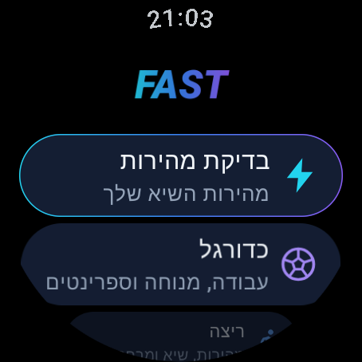 | 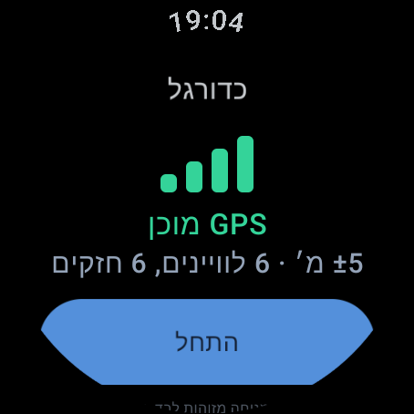 | 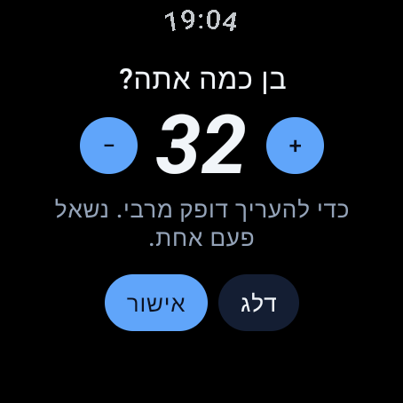 |

## הזרימה

```
בית ─► [הרשאות] ─► [גיל — רק בכדורגל, פעם אחת] ─► מוכן ─► חי ◄─החלקה למעלה─► סיכום-ביניים + סיום
                                                                                    │
                                                                                    ▼
                                                                                 סיכום ─► בית
```

1. **הרשאות** — מיקום (חובה), חיישן דופק והתראות (רשות). מבקשים פעם אחת; סירוב לדופק לא מונע אימון.
2. **גיל** — רק לפני אימון הכדורגל הראשון, כדי להעריך דופק מרבי. אפשר לדלג, ואז אין אזורי דופק. ניתן לשינוי בהגדרות.
3. **מוכן** — אותו מד אות של מבחן הספרינט. הכפתור תמיד פעיל: לפני נעילה כתוב עליו **"התחל בכל זאת"**, וההקלטה פשוט מתחילה למדוד מהדגימה הראשונה. כך אפשר להתחיל כבר ביציאה מחדר ההלבשה.
4. **חי** — ראה למטה.
5. **סיום** — החלקה למעלה לעמוד השני, ו**לחיצה ארוכה** (1.2 שניות, עם טבעת שמתמלאת). נגיעה מקרית לא מסיימת אימון.

## מה רואים בזמן אימון

### כדורגל — מסך אחד שמשתנה לבד

| עבודה | ספרינט | מנוחה |
|---|---|---|
| 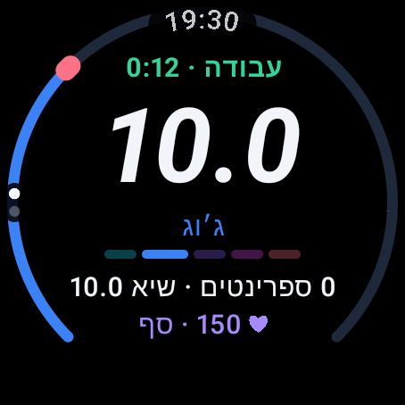 | 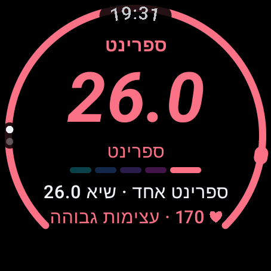 | 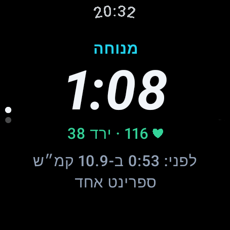 |

- **עבודה:** סטופר הבלוק, מהירות, שם אזור המהירות ופס של חמישה אזורים, מספר הספרינטים ושיא האימון, דופק עם הפענוח (קל / בינוני / סף / עצימות גבוהה).
- **ספרינט:** הטבעת והמספר נצבעים ורוד ברגע שהספרינט מזוהה. **7 שניות אחרי שהוא נגמר** נשארים למעלה השיא, המרחק והמשך שלו — זה הרגע שבו מסתכלים על השעון.
- **מנוחה:** מופיעה אחרי דקה של עמידה, והסטופר כבר מראה את הזמן **מרגע שנעצרת**. מתחתיו הדופק וכמה ירד, וסיכום הבלוק שהסתיים: משך, מהירות ממוצעת, ספרינטים.
- הקשת מסביב: המילוי הוא המהירות עכשיו, והסימן הוורוד הוא שיא האימון.

### ריצה

| חי | סיכום-ביניים וסיום |
|---|---|
| 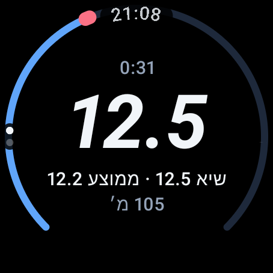 | 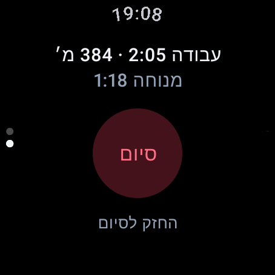 |

מהירות, שיא, ממוצע (בזמן ריצה בלבד), זמן ומרחק. עצירה של 20 שניות ומעלה מזוהה לבד ולא נספרת בממוצע.

### כשאין GPS
המספר מתחלף בקו ("—") עם "אין אות GPS". **מהירות ישנה לא מוצגת כאילו היא עכשיו.**

## הרטט — מה כל אחד אומר

| מתי | איך מרגיש |
|---|---|
| ה-GPS מוכן | שתי נקישות קצרות |
| התחלה | רטט ארוך אחד |
| ספרינט התחיל | רטט קצר וחד |
| הספרינט שנגמר היה שיא האימון | שלוש נקישות, האחרונה ארוכה |
| חזרת לעבודה אחרי מנוחה | קצר ואחריו ארוך |
| מנוחה זוהתה | נקישה אחת חלשה |
| האימון נשמר | שתי נקישות בינוניות |

## מה נשמר, ואיך

- **כל דגימת GPS כמו שהגיעה** (מהירות, אי-ודאות, מיקום, דיוק, כיוון), ו**דופק פעם בשנייה**. לא נשמר שום מספר מחושב — הכול נגזר מחדש בכל קריאה. הפורמט ב-[architecture](../architecture/architecture.md#מודל-הנתונים-coredata).
- **נכתב תוך כדי אימון**, כל 3 שניות לדיסק. אם האפליקציה קורסת או הסוללה נגמרת — מה שנכתב נשאר, ובפתיחה הבאה האימון מופיע בהיסטוריה עם הערה "ההקלטה נקטעה ושוחזרה".
- **אימון ריק לא נשמר.** "ריק" הוא אחד משניים: ה-GPS לא מדד מהירות בכלל (התחלת בפנים וסיימת לפני שננעל), או ש**לא זזת** — השעון לא ראה אפילו 3 שניות במהירות הליכה. במקום סיכום מופיע "האימון לא הושלם", הסיבה, ו"לא נשמר", עם רטט אחד ארוך במקום הכפול. **הליכה נחשבת תנועה** ונשמרת כרגיל.

  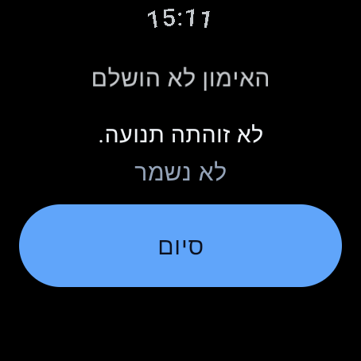

  הקובץ הגולמי של אימון כזה לא נמחק מיד: הוא עובר לתיקייה צדדית על השעון (עשרת האחרונים), למקרה ש"לא זזת" היה בעצם GPS שלא עבד וצריך לברר למה.

## כללים שכדאי להכיר

### מהירות נספרת רק כשדגימה שנייה מאשרת אותה
כל דגימה מוחלפת בחציון שלה ושל שתי שכנותיה. דגימה בודדת שקופצת לא יכולה לקבוע שיא או להתחיל ספרינט — לא על השעון ולא בהיסטוריה. המחיר: המספר על המסך מאחר בשנייה אחת כשמאיצים.
מהירות מעל 45 קמ"ש מושמטת לגמרי: אף אחד לא רץ כך, אז זו נסיעה או תקלת מקלט.

### שכחת לסיים? השעון מסיים לבד
אחרי **20 דקות רצופות של מנוחה** (או 20 דקות בלי אף דגימת GPS) האימון נסגר לבד, **ונחתך לרגע שבו נעצרת** — הזמן שעמדת אחר כך לא נספר כמנוחה. בסיכום ובטלפון מופיעה הערה. הדגימות עצמן נשמרות בקובץ.

### אזורי המהירות מתאימים את עצמם אליך
"ספרינט" בכדורגל הוא 85% ממהירות השיא שלך. מהירות השיא נלקחת ממה שהשעון כבר ראה: השיא שהוחזק 3 שניות באימון כלשהו, או מבחן ספרינט שקיבל אמינות 60 ומעלה. מבחן שהאפליקציה עצמה לא סומכת עליו לא מזיז את האזורים.
עד שיש שיא של 18 קמ"ש לפחות, חלים הספים הסטנדרטיים (ספרינט מ-25.2).
המספר מוצג בהגדרות, כדי שהאזורים לא יהיו תעלומה:

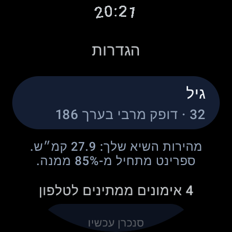

### דופק
נקרא ישירות מהחיישן האופטי של השעון. קריאה שנלקחה כשהשעון לא על היד נזרקת. הדופק מדרג את עוצמת העבודה ומודד התאוששות — **אף פעם לא קובע מנוחה**.

## אחרי האימון

| סיכום | היסטוריה |
|---|---|
| 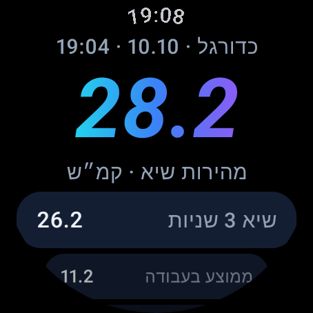 | 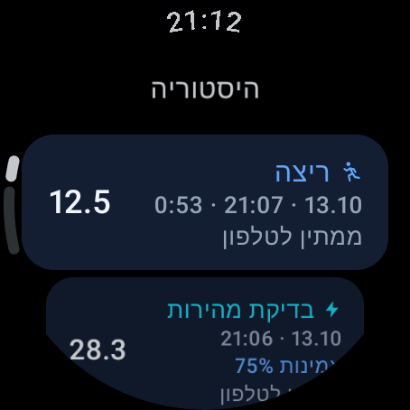 |

הסיכום: מהירות שיא, שיא 3 שניות, ממוצע בעבודה, ספרינטים, זמני עבודה ומנוחה, מרחק, מרחק בריצה מהירה, דופק ממוצע ושיא, ומצב הסנכרון ("ממתין לטלפון" / "סונכרן לטלפון"). כל אימון נשאר בהיסטוריה שעל השעון.

## מה לא נבנה (בכוונה, בינתיים)

| | למה |
|---|---|
| **Pause ידני** | אמרת שאתה שוכח ללחוץ עליו ושוכח לחזור ממנו. עצירות מזוהות לבד בשני המצבים. אם תרצה אותו בריצה — שאלה פתוחה ב-[decisions](../architecture/decisions.md) |
| מצב Ambient | ההקלטה לא תלויה במסך, אז כשהמסך כבוי לא מפסידים כלום; כשמרימים את היד רואים את המצב העדכני |
| Tile / Complication | בזמן הקלטה יש אייקון של FAST על לוח השעון שמחזיר לאימון בנגיעה |
| הקלטה מקבילה דרך Health Services | נדחה עד שיהיו נתונים אמיתיים מה-GPS הישיר להשוות מולם |
| הקפות | לא ביקשת |

## מה נבדק ומה לא

**נבדק על האמולטור** (GPS ודופק מוזרקים לפי תסריט — `tools/sim/simulate.py`):
- אימון כדורגל מלא: ג'וג → ספרינט → עמידה → מנוחה מזוהה אחרי דקה ונספרת מרגע העצירה → חזרה לעבודה → ספרינט שני → סיום. המספרים בסיכום תואמים לתסריט.
- ריצה עם עצירה; מבחן ספרינט אחרי השינויים בקוד המשותף.
- ההקלטה ממשיכה כשיוצאים מהמסך, והשירות וה-GPS משתחררים כשמסיימים או כשעוזבים את מסך "מוכן".
- **שחזור אחרי קריסה:** האפליקציה נהרגה באמצע הקלטה; בפתיחה הבאה האימון הופיע בהיסטוריה עם כל מה שהוקלט עד אותו רגע, ועם ההערה:

  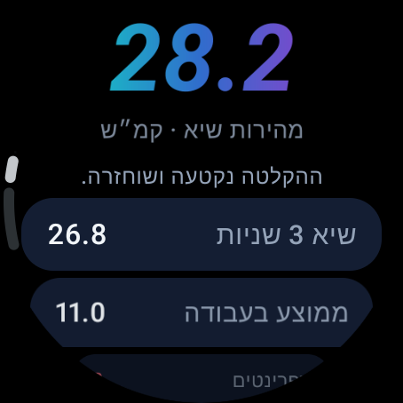
- הקבצים שהשעון כתב נקראו באפליקציית הטלפון ונתנו **אותם מספרים בדיוק**.

**מה שכבר ידוע מה-GPS האמיתי** ([בדיקת 11.10](../research/field-tests/2026-10-11-first-real-gps.md)): דגימה בשנייה, מהירות בכל דגימה, מיקום ראשון תוך 7–14 שניות כשיש לוויינים. המקלט לא מדרג את הדיוק של עצמו, אז מסך "מוכן" שופט לפי לוויינים.

**לא נבדק, ואי אפשר לבדוק בלי אימון אמיתי:**
- **הספים** (דקה, 12 מ', 85%) עדיין מכוילים על נתונים מדומים.
- **חיישן הדופק של OnePlus Watch 2 בפועל.** לפי מה שהשעון מצהיר, הוא מדווח לפחות פעם ב-5 שניות, וזה מתאים למה שנבנה (האפליקציה מפסיקה להאמין לדופק שלא התעדכן דקה). איך זה מתנהג באימון אמיתי עם מסך כבוי — עוד לא נבדק.
- **סוללה.** ההקלטה מחזיקה את המעבד ער לכל אורך האימון; כמה זה עולה — לא נמדד.
- **רטט** — האמולטור לא רוטט.
- **סנכרון לטלפון מקצה לקצה** — ראה [phone-app](phone-app.md#סנכרון).
