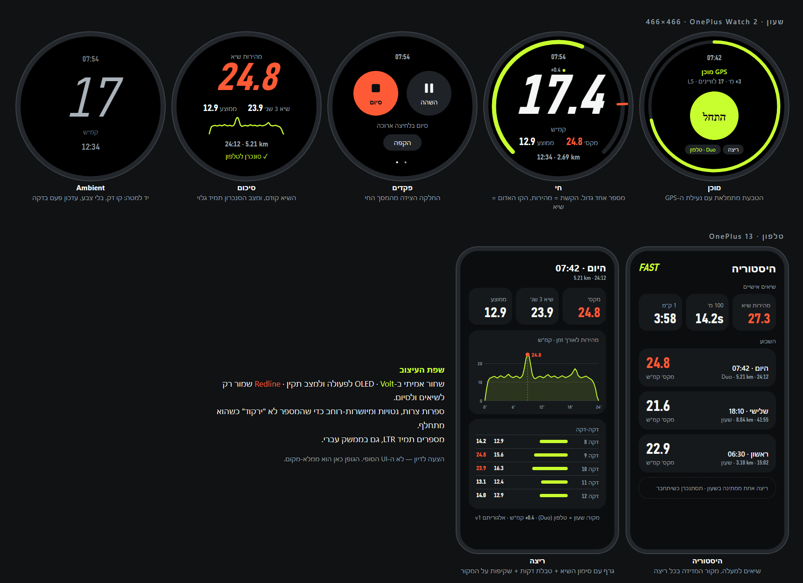

# אפיון UX — שעון וטלפון

> הצעה לדיון. ה-mockups הם סקיצה סטטית ולא ה-UI הסופי.



קובץ המקור: [mockups.html](../design/mockups.html).

## עקרונות

1. **מבט של חצי שנייה.** בריצה מסתכלים על השעון לרגע. המספר הראשי תופס את רוב המסך ונקרא בלי מיקוד.
2. **נגיעה אחת, אצבע מיוזעת.** מטרות מגע גדולות (48dp ומעלה), ופעולות הרסניות בלחיצה ארוכה.
3. **צבע = משמעות.** Volt לפעולה ולמצב תקין. Redline רק לשיאים ולסיום. אין צבע קישוטי.
4. **המסך עגול.** תוכן חשוב במרכז; הקצוות לקשת המהירות ולשעה.
5. **אף פעם לא לתהות אם זה מקליט.** מצב ההקלטה, ה-GPS והסנכרון תמיד גלויים.
6. **מספרים לא רוקדים.** ספרות ברוחב קבוע, כך שהמספר לא זז כשהוא מתחלף.

## שעון

### זרימה
```
לוח השעון ─(Tile / Complication / כפתור)─► מוכן ─► חי ◄─החלקה─► פקדים
                                              │              │
                                              ▼              ▼
                                          היסטוריה        סיכום ─► חזרה ל"מוכן"
```

### מוכן
- GNSS נדלק מיד עם פתיחת המסך; טבעת סביב המסך מתמלאת עם איכות הנעילה.
- שורת מצב: דיוק במטרים, מספר לוויינים, האם יש L5.
- כפתור **התחל** גדול במרכז. אפור עד לנעילה טובה; נגיעה כשהוא אפור שואלת "להתחיל בלי GPS מלא?".
- תגיות קטנות: פרופיל הפעילות, ו-"Duo" כשהטלפון מחובר ומשתתף.
- אם אפליקציה אחרת מקליטה אימון — אזהרה לפני שעוצרים לה אותו.
- החלקה למעלה: היסטוריה והגדרות.

### חי
- **מהירות נוכחית** — הכי גדול שאפשר, במרכז.
- **קשת** של 270° סביב המסך: המילוי הוא המהירות הנוכחית, והקו האדום מסמן את שיא הריצה. הסקאלה מתאימה את עצמה לפרופיל.
- שורה שנייה: **מקס'** (באדום) ו**ממוצע**.
- שורה תחתונה: זמן ומרחק.
- נקודת איכות אות + אי-ודאות (±) ליד המספר. כשהאות חלש המספר מתעמעם, כדי שיהיה ברור שהוא פחות אמין.
- **רטט קצר** על שיא חדש.

### פקדים
- החלקה הצידה מהמסך החי. שני כפתורים גדולים: **השהה/המשך** ו**סיום**.
- סיום דורש לחיצה ארוכה, עם טבעת התקדמות. אין דיאלוג אישור נפרד.
- **הקפה** — מסמן נקודה ומתחיל מקטע חדש. ❓ האם למפות לכפתור הפיזי.

### Ambient (יד למטה)
- שחור, קו דק, בלי צבע ובלי אנימציה. מהירות וזמן בלבד.
- מתעדכן פעם בדקה לפי כללי המערכת. ברגע שמרימים את היד התצוגה המלאה חוזרת עם הנתונים המעודכנים.
- אפשרות בהגדרות: "מסך דולק בזמן ריצה", עם מחיר בסוללה.

### סיכום
- **מהירות שיא** ראשונה ובאדום, אחריה שיא 3 שניות וממוצע.
- גרף מהירות קטן, מרחק וזמן.
- מצב סנכרון: "סונכרן לטלפון ✓" או "ממתין לטלפון".
- אם הריצה שוחזרה אחרי קריסה — מצוין במפורש.

### היסטוריה והגדרות
- רשימת הריצות האחרונות: תאריך, מקס', ומחוון סנכרון. נגיעה פותחת את הסיכום.
- הגדרות: יחידות, רטט, מסך דולק, פרופיל, ו"בדיקת מכשיר" (המסך שכבר קיים בשלד).

### נקודות כניסה מהירות
- **Tile:** כפתור התחלה + השיא האחרון.
- **Complication:** התחלה מלוח השעון.
- **הכפתור הפיזי** של OnePlus: אפשר להקצות אותו לפתיחת FAST בהגדרות המערכת.

## טלפון

### היסטוריה (מסך הבית)
- **שיאים אישיים** למעלה: מהירות שיא, 100 מ', 1 ק"מ.
- רשימת ריצות, מקובצת לפי שבוע. כל כרטיס: מתי, מרחק, משך, **מקור המדידה** (שעון / טלפון / Duo), ומהירות השיא בגדול.
- שורה מקווקוות כשיש ריצות שעדיין ממתינות בשעון.
- מצב ריק: הסבר איך מתחילים מהשעון + מצב החיבור לשעון.

### ריצה
- שלושה אריחים: מקס', שיא 3 שנ', ממוצע.
- **גרף מהירות לאורך זמן** עם סימון השיא. גרירה על הגרף מציגה את המהירות בכל רגע.
- **טבלה דקה-דקה:** ממוצע ומקסימום לכל דקה, עם פס חזותי. זו התשובה הישירה ל"מה הייתה המהירות לאורך הדקות".
- שורת שקיפות: מקור, אי-ודאות, וגרסת האלגוריתם.
- פעולות: שיתוף/ייצוא, מחיקה (עם אישור).

### מצב חי (V1)
כשהשעון מקליט והטלפון בטווח — מסך חי גדול בטלפון. שימושי כשהטלפון על הכידון או אצל מישהו שצופה.

## RTL ושפה

- שני הממשקים דו-לשוניים ועוקבים אחרי שפת המכשיר.
- בעברית הפריסה RTL מלאה, **חוץ ממספרים, יחידות וגרפים** שנשארים LTR (ציר הזמן תמיד משמאל לימין).
- נתונים טכניים באנגלית (כמו מסך "בדיקת מכשיר") מוצגים LTR גם בממשק עברי. זה כבר מיושם ונבדק — בלי זה ערכים כמו "16 (API 36)" מתהפכים.

## נגישות

- ניגודיות: Volt על שחור ו-Ice על שחור עוברים AAA.
- אדום וירוק-צהוב לעולם לא נושאים משמעות לבדם — תמיד יש גם תווית או מיקום.
- תמיכה בגודל גופן מערכת, עם בדיקה שהמספר הראשי לא נחתך בגודל המרבי.
