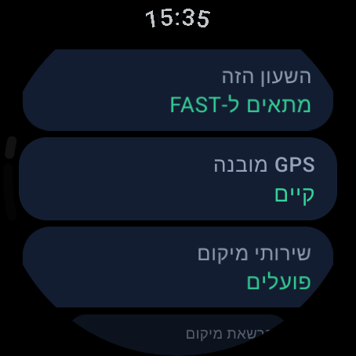

# אפיון UX — שעון וטלפון

> הצעה לדיון. ה-mockups הם סקיצה סטטית ולא ה-UI הסופי.


קובץ המקור: [mockups.html](../design/mockups.html).

## עקרונות

1. **מבט של חצי שנייה.** בריצה מסתכלים על השעון לרגע. המספר הראשי תופס את רוב המסך ונקרא בלי מיקוד.
2. **נגיעה אחת, אצבע מיוזעת.** מטרות מגע גדולות (48dp ומעלה), ופעולות הרסניות בלחיצה ארוכה.
3. **צבע = משמעות.** כחול לפעולה, מנטה ל"תקין", ורוד רק לשיאים ולספרינט. הפלטה ב-[brand.md](../brand/brand.md).
4. **המסך עגול.** תוכן חשוב במרכז; הקצוות לקשת המהירות ולשעה.
5. **אף פעם לא לתהות אם זה מקליט.** מצב ההקלטה, ה-GPS והסנכרון תמיד גלויים.
6. **מספרים לא רוקדים.** ספרות ברוחב קבוע, כך שהמספר לא זז כשהוא מתחלף.

## שעון

### זרימה
```
לוח השעון ─(Tile / Complication / כפתור)─► מוכן ─► חי ◄─החלקה─► פקדים
                                              │              │
                                              ▼              ▼
                                          היסטוריה        סיכום ─► חזרה ל"מוכן"
```

### מוכן
- GNSS נדלק מיד עם פתיחת המסך; טבעת סביב המסך מתמלאת עם איכות הנעילה.
- שורת מצב: דיוק במטרים, מספר לוויינים, האם יש L5.
- כפתור **התחל** גדול במרכז. אפור עד לנעילה טובה; נגיעה כשהוא אפור שואלת "להתחיל בלי GPS מלא?".
- תגית המצב (**ריצה / כדורגל**) — נגיעה מחליפה. המצב האחרון נזכר.
- אם אפליקציה אחרת מקליטה אימון — אזהרה לפני שעוצרים לה אותו.
- החלקה למעלה: היסטוריה והגדרות.

### חי
- **מהירות נוכחית** — הכי גדול שאפשר, במרכז.
- **קשת** של 270° סביב המסך: המילוי הוא המהירות הנוכחית, והסימן הוורוד הוא שיא האימון.
- שורה שנייה: **שיא** (בוורוד) ו**ממוצע**.
- שורה תחתונה: זמן ומרחק.
- נקודת איכות אות + אי-ודאות (±) ליד המספר. כשהאות חלש המספר מתעמעם, כדי שיהיה ברור שהוא פחות אמין.
- **רטט קצר** על שיא חדש.

### פקדים
- החלקה הצידה מהמסך החי. שני כפתורים גדולים: **השהה/המשך** ו**סיום**.
- סיום דורש לחיצה ארוכה, עם טבעת התקדמות. אין דיאלוג אישור נפרד.
- **הקפה** — מסמן נקודה ומתחיל מקטע חדש. ❓ האם למפות לכפתור הפיזי.

### Ambient (יד למטה)
- שחור, קו דק, בלי צבע ובלי אנימציה. מהירות וזמן בלבד.
- מתעדכן פעם בדקה לפי כללי המערכת. ברגע שמרימים את היד התצוגה המלאה חוזרת עם הנתונים המעודכנים.
- אפשרות בהגדרות: "מסך דולק בזמן ריצה", עם מחיר בסוללה.

### סיכום
- **מהירות שיא** ראשונה ובגרדיאנט המותג, אחריה שיא 3 שניות וממוצע.
- גרף מהירות קטן, מרחק וזמן.
- מצב סנכרון: "סונכרן לטלפון ✓" או "ממתין לטלפון".
- אם הריצה שוחזרה אחרי קריסה — מצוין במפורש.

### מצב כדורגל

אותו מסך "מוכן" ואותם פקדים. בזמן האימון השעון מחליף לבד בין שלושה מסכים, לפי מה שאתה עושה:

**עבודה**
- תגית מצב למעלה עם **סטופר הבלוק הנוכחי** ("עבודה · 04:12").
- מהירות נוכחית גדולה, ומתחתיה שם האזור (הליכה / ג'וג / ריצה / מהירה / ספרינט).
- **פס אזורים:** חמישה מקטעים בצבעי הסקאלה, הנוכחי מודגש.
- ספרינטים עד כה + שיא האימון.
- שורת דופק עם הפענוח: קל / בינוני / **סף** / עצימות גבוהה.

**ספרינט**
- המסך מתחלף לבד ברגע שחוצים את סף הספרינט, עם טבעת ורודה ורטט.
- המהירות בגדול ובוורוד; בסיום הספרינט מוצגים המרחק והמשך שלו לכמה שניות.
- "שיא חדש" אם נשבר שיא האימון.

**מנוחה**
- מופיע אחרי דקה של עמידה במקום, עם סטופר שכבר סופר מרגע העצירה.
- **התאוששות דופק:** הדופק הנוכחי וכמה ירד בדקה.
- סיכום הבלוק שהסתיים: משך, מהירות ממוצעת, ספרינטים.
- חזרה לתנועה מחזירה למסך העבודה עם רטט ("כניסה לעבודה"). אין צורך לגעת בשעון.

**סיכום כדורגל**
- פס עבודה/מנוחה עם הזמנים, מהירות שיא, מספר ספרינטים, **ומהירות ממוצעת בעבודה**.

המצבים והספים מוגדרים ב-[06](../research/06-football-tracking.md#הפענוח-מה-מוצג-ומתי).

### היסטוריה והגדרות
- רשימת האימונים האחרונים: תאריך, מצב, שיא, ומחוון סנכרון. נגיעה פותחת את הסיכום.
- הגדרות: יחידות, רטט, מסך דולק, **סף מנוחה** (30–180 שניות), **דופק מרבי** (או גיל), ו"בדיקת מכשיר" (המסך שכבר קיים).

### בדיקת מכשיר
נפתח ב**תאימות** בשפת המשתמש: שורת סיכום ("השעון הזה — מתאים ל-FAST"), ואחריה כל מה שהאפליקציה נשענת עליו ומה מצבו — GPS מובנה, שירותי מיקום, הרשאת מיקום, נתוני מהירות ומרחק, חיישן דופק, חיישני תנועה, וטלפון מחובר. מה שחסר מקבל גם הסבר מה לעשות.

מתחת: הפירוט הטכני (באנגלית), ובסופו **רשימת כל החיישנים שהשעון מצהיר עליהם**, כולל אלה של היצרן. שם מתגלים "אקסטרות" שאף בדיקה רגילה לא שואלת עליהן.



### נקודות כניסה מהירות
- **Tile:** כפתור התחלה + השיא האחרון.
- **Complication:** התחלה מלוח השעון.
- **הכפתור הפיזי** של OnePlus: אפשר להקצות אותו לפתיחת FAST בהגדרות המערכת.

## טלפון

### היסטוריה (מסך הבית)
- **שיאים אישיים** למעלה: מהירות שיא, 100 מ', 1 ק"מ.
- ריצות ואימוני כדורגל באותה רשימה, מקובצים לפי שבוע. כל כרטיס: מתי, **מצב**, הנתון המרכזי של המצב (מרחק ומשך בריצה; זמן עבודה וספרינטים בכדורגל), ומהירות השיא בגדול.
- שורה מקווקוות כשיש ריצות שעדיין ממתינות בשעון.
- מצב ריק: הסבר איך מתחילים מהשעון + מצב החיבור לשעון.

### ריצה
- שלושה אריחים: מקס', שיא 3 שנ', ממוצע.
- **גרף מהירות לאורך זמן** עם סימון השיא. גרירה על הגרף מציגה את המהירות בכל רגע.
- **טבלה דקה-דקה:** ממוצע ומקסימום לכל דקה, עם פס חזותי. זו התשובה הישירה ל"מה הייתה המהירות לאורך הדקות".
- שורת שקיפות: מקור, אי-ודאות, וגרסת האלגוריתם.
- פעולות: שיתוף/ייצוא, מחיקה (עם אישור).

### אימון כדורגל
- שישה אריחים: זמן עבודה, מנוחה, ספרינטים · מהירות שיא, ממוצע בעבודה, מרחק בריצה מהירה.
- **ציר זמן:** בלוקי עבודה ומנוחה לאורך האימון, עם המהירות מצוירת מעל כל בלוק עבודה. מנוחות ארוכות מסומנות במשך שלהן.
- **זמן בכל אזור מהירות**, בצבעי הסקאלה.
- **רשימת ספרינטים:** מתי, מרחק, משך ושיא. נגיעה קופצת אליו בשידור החוזר.
- דופק: זמן באזורים, עומס אימון, והתאוששות בכל מנוחה.

### שידור חוזר
- המגרש מצויר בקנה מידה אמיתי, והמסלול **מתנגן כמו סרטון**: נקודה שנעה בזמן מואץ ומשאירה שובל צבוע לפי מהירות.
- פס התקדמות לגרירה, מהירות ניגון, ומהירות רגעית מוצגת בפינה.
- מתג: מסלול / מפת חום / ספרינטים בלבד.
- ❓ רקע של מפה או תצלום אוויר — ראה [decisions](../architecture/decisions.md).

## RTL ושפה

- שני הממשקים דו-לשוניים ועוקבים אחרי שפת המכשיר.
- בעברית הפריסה RTL מלאה, **חוץ ממספרים, יחידות וגרפים** שנשארים LTR (ציר הזמן תמיד משמאל לימין).
- נתונים טכניים באנגלית (כמו מסך "בדיקת מכשיר") מוצגים LTR גם בממשק עברי. זה כבר מיושם ונבדק — בלי זה ערכים כמו "16 (API 36)" מתהפכים.

## נגישות

- ניגודיות: Sky ו-Ice על שחור עוברים AAA; טקסט על כפתור כחול הוא לבן ומודגש.
- צבע לעולם לא נושא משמעות לבדו — אזור מהירות מוצג גם בשם ובמיקום בפס, לא רק בגוון.
- תמיכה בגודל גופן מערכת, עם בדיקה שהמספר הראשי לא נחתך בגודל המרבי.
